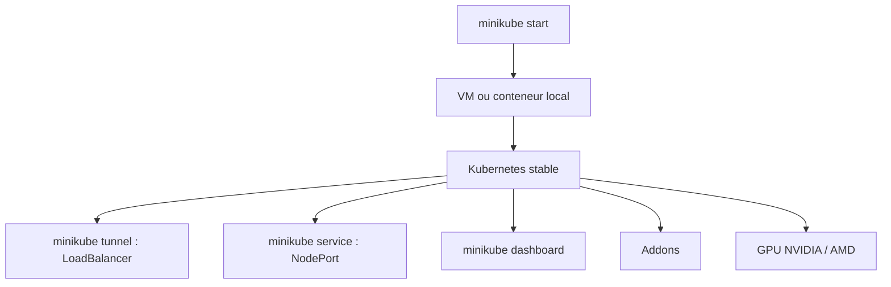

# kubernetes/minikube

> Local Kubernetes cluster on macOS, Linux and Windows, for developing and testing applications.

## The problem
Developing a Kubernetes application without a cluster forces you to deploy to a shared environment on every try.
Testing a LoadBalancer, a PersistentVolume or a GPU locally is far from obvious.

## What it actually does
Runs the latest stable version of Kubernetes locally, with LoadBalancer via `minikube tunnel`, multi-cluster via `minikube start -p`, NodePorts via `minikube service`, persistent volumes and a dashboard via `minikube dashboard`.
Selectable container runtime (`minikube start --container-runtime`) and apiserver/kubelet options passable as command-line arguments.
Addons: a marketplace where developers share service configurations to run on minikube.
NVIDIA and AMD GPU support for machine learning, filesystem mounts, and compatibility with common CI environments.

## How it is wired

## Trying it
The README contains no command block: it points to the "Getting Started Guide", a GitHub Codespace and Dev Containers. The commands quoted in its text (`minikube start`, `minikube dashboard`) are not presented as an installation procedure.

## Cost and gotchas
Free. The resource consumed is local: your machine's CPU, RAM and disk.
The README is very short and delegates everything to the external documentation and the official site.

## What it is not
It is not a production cluster: the stated goal is local development of Kubernetes applications.
It is not a lightweight distribution like k3s: minikube runs Kubernetes as is in a VM or a container.
It is not a realistic multi-node environment by default.

## Alternatives
No alternative is named in the README.

## For you
The default choice for testing a manifest or an operator before pushing it; k3s if you want something lighter.
