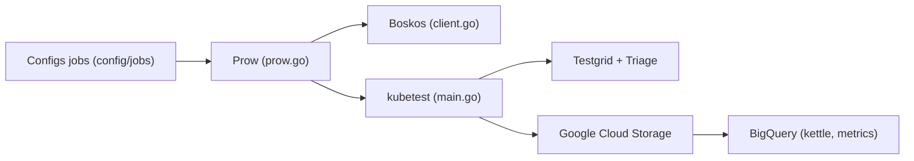

# kubernetes/test-infra

> CI tools and configurations of the Kubernetes project: Prow, Testgrid, Boskos, kubetest and dashboards.

## The problem
A project the size of Kubernetes must run its tests, manage its test resources and merge PRs automatically.

## What it actually does
It is a set of tools rather than a single service. Prow (prow.k8s.io) drives CI from job configurations in `config/jobs`, deployed after PR review. Boskos lends GCP projects, kubetest2 creates test clusters, Testgrid and Triage present results and failures, Deck and Tide show jobs and merges, gcsweb displays artifacts, kettle loads BigQuery, ghproxy caches GitHub, label_sync manages labels.

## How it is wired


## Trying it
```bash
# Aucune commande dans le README : il renvoie à la documentation pour
# ajouter, tester localement ou supprimer des configurations de jobs.
```

## Cost and gotchas
Free, but designed for Kubernetes infrastructure (GCP, GCS, BigQuery, GitHub); hard to reuse outside that context. The README's architecture diagram is flagged as needing an update.

## What it is not
Not a turnkey CI for your project; these are the internal tools of one specific project. The Prow components are documented elsewhere.

## Alternatives
Not documented in the README: no alternative named.

## For you
Ignore it, unless you contribute to Kubernetes: you will find ideas for large-scale CI, but nothing to adopt for an ordinary data or AI project.
