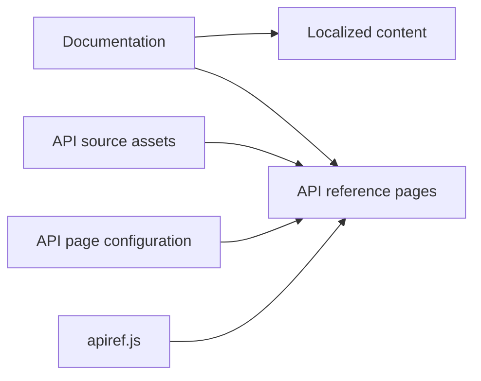

# kubernetes/website

> Sources of the Kubernetes website and documentation, for contributors and translators.

## The problem
The official documentation must be versioned, translated and generated reproducibly.

## What it actually does
Hugo repository (Extended version) with the Docsy theme installed via npm. Content: docs, blog, case studies, versions, reference API generated from the Kubernetes Swagger specification. Localizations in several languages. Hugo segments to speed up previews.

## How it is wired


## Trying it
```bash
git clone https://github.com/kubernetes/website.git
cd website
make module-init
make container-serve
make container-serve segments=en,ko
```

## Cost and gotchas
Free. The container may fail for lack of CPU/RAM; the Hugo version is pinned in `netlify.toml`.

## What it is not
Not Kubernetes itself: it is its documentation site.

## Alternatives
No alternative cited in the README.

## For you
Watch: useful only to contribute to or fix the K8s docs.
