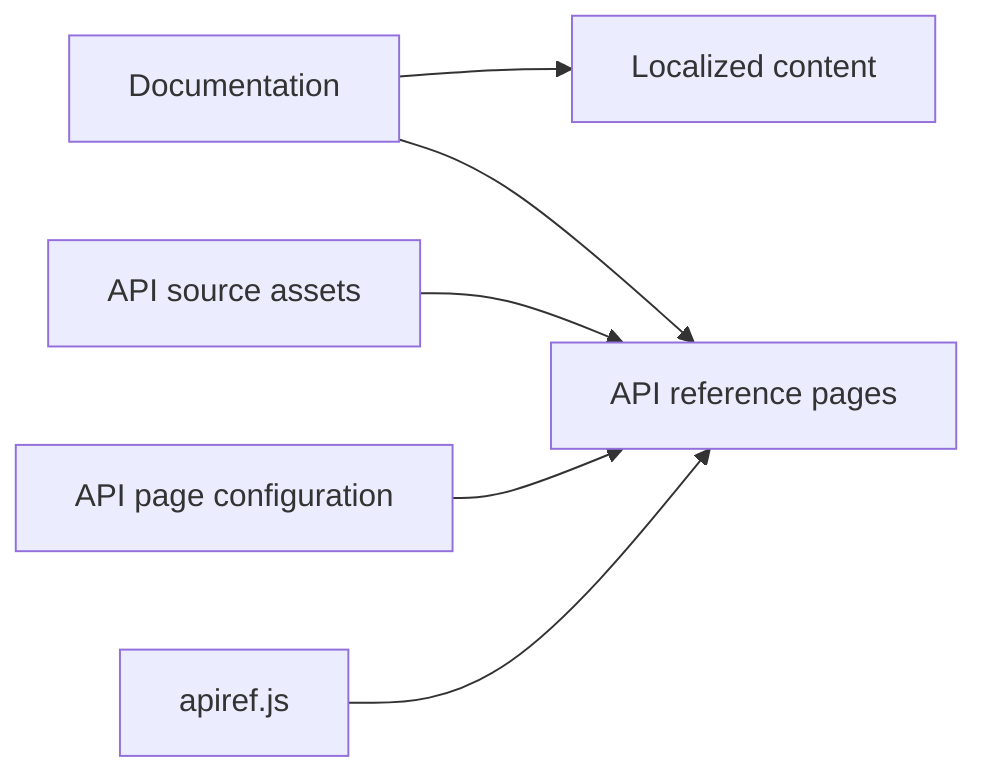

# kubernetes/website

> Sources du site et de la documentation Kubernetes, pour contributeurs et traducteurs.

## Le problème
La documentation officielle doit être versionnée, traduite et générée de manière reproductible.

## Ce que ça fait vraiment
Dépôt Hugo (version Extended) avec thème Docsy installé par npm. Contenu : docs, blog, études de cas, versions, API de référence générée depuis la spécification Swagger de Kubernetes. Localisations en plusieurs langues. Segments Hugo pour accélérer les aperçus.

## Comment c'est branché


## Essayer
```bash
git clone https://github.com/kubernetes/website.git
cd website
make module-init
make container-serve
make container-serve segments=en,ko
```

## Coût et pièges
Gratuit. Le conteneur peut échouer faute de CPU/RAM ; la version de Hugo est fixée dans `netlify.toml`.

## Ce que ce n'est pas
Pas Kubernetes lui-même : c'est son site de documentation.

## Alternatives
Aucune alternative citée dans le README.

## Pour toi
À surveiller : utile seulement pour contribuer ou corriger la doc K8s.

