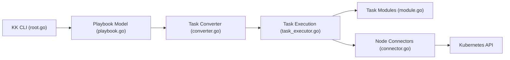

# kubesphere/kubekey

> Ansible-inspired task workflow execution tool for installing and managing Kubernetes clusters.

## The problem
Installing, extending and upgrading a Kubernetes cluster (online or offline) takes a lot of manual scripts.

## What it actually does
The `kk` binary runs playbooks and roles (git or local projects) through local, SSH, Kubernetes or Prometheus connectors. Bundled playbooks cover cluster creation/deletion, adding/removing nodes, certificate renewal, offline artifact export. Kubernetes controllers (Playbook, Inventory, KKCluster, KKMachine) allow cloud-native control, and a web interface exists since v4.

## How it is wired


## Trying it
```bash
curl -sfL https://get-kk.kubesphere.io | sh -
./kk create cluster
./kk web --schema-path web-installer/schema --ui-path web-installer/dist
```

## Cost and gotchas
Free; you need reachable machines (SSH). The README notes an advanced UI "not yet open" for some of the features.

## What it is not
Not a simple installer: since 3.x it is a generic task engine. Not a managed Kubernetes.

## Alternatives
No alternative named in the README (compared to Ansible for workflow design).

## For you
Worth watching: useful if you build clusters yourself (on-prem GPU), otherwise a managed Kubernetes spares you this tooling.
