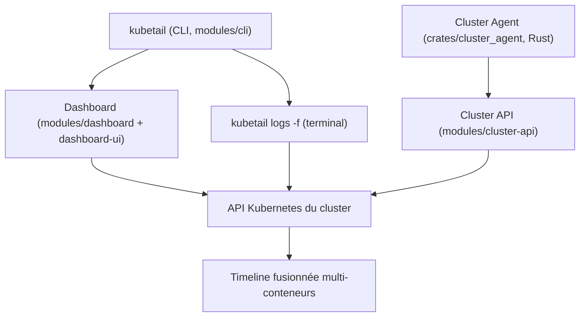

# kubetail-org/kubetail

> Real-time dashboard that merges the logs of all the containers of a workload.

## The problem
Following a request that crosses several ephemeral containers forces you to open as many `kubectl logs` as there are containers and stitch the timeline back together by hand.

## What it actually does
The `kubetail` CLI is the entry point: it launches a local web dashboard or sends the raw logs straight to the terminal. Messages from all the containers of a Deployment or a DaemonSet appear in a single chronological timeline. Filtering is done by workload, by absolute or relative time range, by node property (availability zone, CPU architecture, node identifier) and by grep. Logs are fetched through the cluster's Kubernetes API, so nothing is sent to an external service; the same API is used to follow container lifecycle events to keep the timeline consistent when a container starts, stops or is replaced. Works on the desktop, in a cluster or in Docker; switches between several clusters in desktop mode.

## How it is wired


## Trying it
```bash
brew install kubetail
curl -sS https://www.kubetail.com/install.sh | bash
kubetail serve
kubetail logs -f deployments/my-app
kubetail cluster install
kubetail config init
```

## Cost and gotchas
Free, and private by default since the data never leaves your cluster. The advanced features require installing the Kubetail API **inside** the cluster (`kubetail cluster install`), which is no longer a simple local tool. Switching clusters is reserved for desktop mode. Sixteen installation methods are listed (Krew, Snap, Winget, apt, dnf, zypper, apk, AUR, Nix, asdf, Chocolatey, Scoop, MacPorts…).

## What it is not
It is not a log platform with retention and indexing: it reads the Kubernetes API live and does not store anything. So it is not a replacement for Loki or Elastic for long history. No alerting is described.

## Alternatives
- No alternative named in the README.

## For you
Immediate comfort when you debug a training job spread across several pods.
