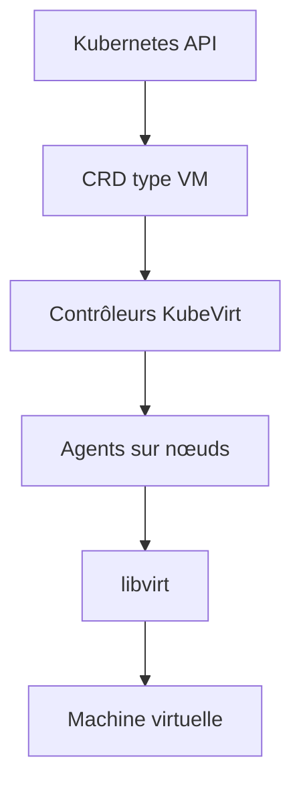

# kubevirt/kubevirt

> Kubernetes add-on for managing virtual machines as native cluster resources.

## The problem
Making VMs and containers coexist under a single API usually requires two separate management planes. Migrating VM workloads to Kubernetes has no common ground.

## What it actually does
Extends Kubernetes via CRDs (a `VM` type) to manage VMs alongside other resources. Adds controllers and agents that provide the business logic: create, schedule, start, stop, delete a VM declaratively. Relies on libvirt.

## How it is wired

## Trying it
No installation command in the README (it points to the quickstart on kubevirt.io). Write it yourself: documentation to consult at kubevirt.io/docs.

## Cost and gotchas
Free. Requires a working Kubernetes cluster and virtualization-capable nodes. Contributions are subject to the Developer Certificate of Origin (`git commit -s`).

## What it is not
Not a standalone hypervisor: it is an extension of Kubernetes, without a cluster there is nothing.

## Alternatives
- Libvirt: the underlying layer, without the Kubernetes integration.
- Cockpit: management interface mentioned as a related resource.

## For you
Out of data/AI scope unless you need to run legacy VMs alongside your ML workloads on Kubernetes.
