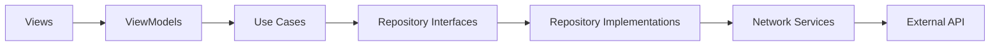

# kudoleh/iOS-Clean-Architecture-MVVM

> iOS template project in Clean Architecture and MVVM, with a movie search as an example.

## The problem
Structuring an iOS app into testable layers, without the domain depending on the interface or the network.

## What it actually does
Three layers: Domain (entities, use cases, repository interfaces), Data (repositories, network, CoreData persistence) and Presentation (ViewModels, views). Illustrated: dependency injection, flow coordinators, DTOs, cache, pagination, unit tests, SwiftUI or UIKit view on the same ViewModel.

## How it is wired

## Trying it
No command documented: open the project in Xcode (11.2.1 or later).

## Cost and gotchas
Free. No license declared, which complicates reuse as a template. The cited CI (Travis) is probably obsolete.

## What it is not
Not a library: a project to copy and rename ("Movie"). A variant with views in code exists in another repository.

## Alternatives
- iOS-Clean-Architecture-MVVM-Views-In-Code: same idea without storyboards.

## For you
Ignore: iOS architecture template, outside the data/AI/MLOps scope.
