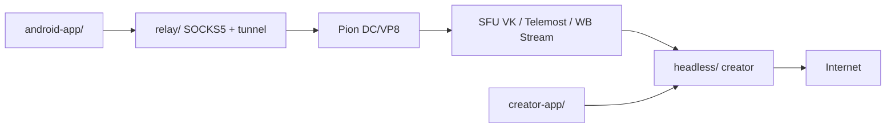

# kulikov0/whitelist-bypass

> Tunnels internet traffic through video calls (VK, Telemost, WB Stream) to get around whitelist-based censorship.

## The problem
Where only authorized services are reachable, access to the rest of the internet is cut off; the tool aims to restore a channel by relying on authorized video-call platforms.

## What it actually does
- Two roles: a "creator" (on the free internet) who opens the call, and a "joiner" (restricted network) who joins it and exposes a SOCKS5 proxy or an Android VPN.
- TCP/UDP traffic is carried either by DataChannel or encoded in a VP8 video track; optional ChaCha20 obfuscation (headless mode).
- Recommended path: Go binaries (Pion) without a browser; the old Electron/WebView path is end-of-life.
- Android, iOS (SOCKS5 proxy only) and Linux clients.

## How it is wired


## Trying it
```bash
./build-headless.sh
./headless/telemost-joiner/headless-telemost-joiner --tm-link <link> --socks-port 1080
```

## Cost and gotchas
Free, but depends on accounts and third-party Russian services whose APIs may change; the creator side requires cookies exported from a logged-in account. Use should be assessed against local law and the platforms' terms of service; risk of account blocking.

## What it is not
Not a commercial VPN nor a guarantee of anonymity: nothing in the README establishes one. Installation documentation is mainly in Russian (docs/SETUP.md).

## Alternatives
No alternative named in the README.

## For you
Ignore: network circumvention tool with no data/AI/MLOps use, fragile because it relies on third-party platform APIs and is run by a single person.
