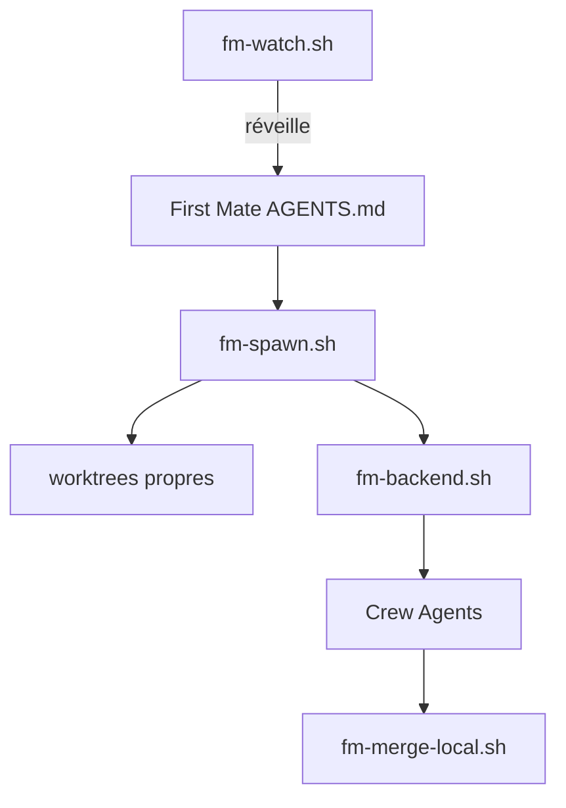

# kunchenguid/firstmate

> Agent distribution: you talk to one agent, it drives a team of coding agents in parallel.

## The problem
As soon as you launch several coding tasks in parallel, you juggle tabs, hand-copied contexts and forgotten sessions.

## What it actually does
The cloned repo is the "distro": `AGENTS.md`, skills and shell scripts. Launched from a compatible harness (Claude Code, Grok, Pi, Codex, OpenCode, Cursor), the first agent creates a git worktree per task, starts agents in tmux or another backend, monitors them with a token-free bash watcher, then returns PRs, local merges or reports. Options: remote second mates, X/Discord relays, voice.

## How it is wired


## Trying it
```bash
gh auth login
git clone https://github.com/kunchenguid/firstmate
cd firstmate
claude
```

## Cost and gotchas
You need an agent harness with its subscription or key, an authenticated `gh` and tmux by default. Each agent in the crew consumes tokens. macOS and Linux only. 2,514 open issues.

## What it is not
Neither a model, nor an MCP, nor a CLI to install: these are instructions for agents. The Zellij, Orca, cmux, Paseo and Rex backends are experimental according to the README.

## Alternatives
No alternative named in the README.

## For you
Keep an eye on it: multi-agent orchestration via worktrees is an interesting pattern, but the project is young, single-maintainer and heavy on options.
