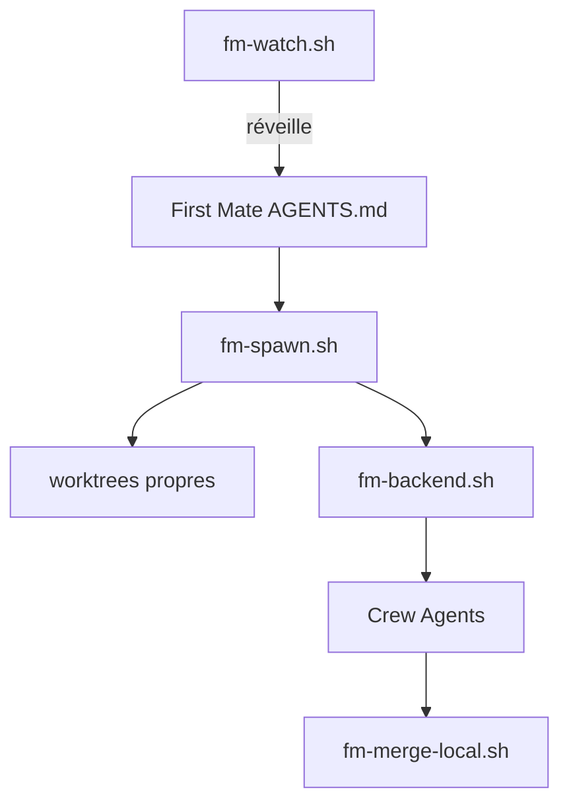

# kunchenguid/firstmate

> Distribution d'agents : tu parles à un agent, il pilote une équipe d'agents de code en parallèle.

## Le problème
Dès que tu lances plusieurs tâches de code en parallèle, tu jongles entre onglets, contextes copiés à la main et sessions oubliées.

## Ce que ça fait vraiment
Le dépôt cloné est la « distro » : `AGENTS.md`, des skills et des scripts shell. Lancé depuis un harnais compatible (Claude Code, Grok, Pi, Codex, OpenCode, Cursor), le premier agent crée un worktree git par tâche, démarre des agents dans tmux ou un autre backend, les surveille par un watcher bash sans jetons, puis rend des PR, des fusions locales ou des rapports. Options : second mates distants, relais X/Discord, voix.

## Comment c'est branché


## Essayer
```bash
gh auth login
git clone https://github.com/kunchenguid/firstmate
cd firstmate
claude
```

## Coût et pièges
Il faut un harnais d'agent avec son abonnement ou sa clé, `gh` authentifié et tmux par défaut. Chaque agent de l'équipe consomme des jetons. macOS et Linux seulement. 2 514 issues ouvertes.

## Ce que ce n'est pas
Ni un modèle, ni un MCP, ni un CLI à installer : ce sont des instructions pour agents. Les backends Zellij, Orca, cmux, Paseo, Rex sont expérimentaux selon le README.

## Alternatives
Aucune alternative nommée dans le README.

## Pour toi
Surveiller : l'orchestration multi-agents par worktrees est un patron intéressant, mais projet jeune, mono-mainteneur et très chargé en options.

