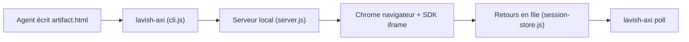

# kunchenguid/lavish-axi

> CLI that opens an agent's HTML artifacts in a local browser so you can annotate them and send feedback back.

## The problem
Reviewing an HTML document produced by an agent comes down to screenshots and long replies of the "here is what to change" kind.

## What it actually does
`lavish-axi <file>` starts a local server and displays the artifact in an isolated iframe; the user annotates elements or text, edits Mermaid diagrams as whiteboards, and sends messages. `lavish-axi poll` waits for this feedback and hands it back to the agent. Standalone HTML export, optional sharing to ht-ml.app (third party), session hooks.

## How it is wired


## Trying it
```bash
npx skills add kunchenguid/lavish-axi --skill lavish
npx -y lavish-axi --help
npm install -g lavish-axi
lavish-axi setup hooks
```

## Cost and gotchas
Free. Sharing sends the artifact to ht-ml.app, public by default; it cannot be deleted. A telemetry module exists (`telemetry.js`) and should be examined. Network listening: with Tailscale, the unauthenticated server becomes reachable on the tailnet.

## What it is not
Not a document editor or a cloud service: a local loop for reviewing artifacts. Recent repo (May 2026), with many features that are still evolving.

## Alternatives
- No alternative cited in the README.

## For you
Worth watching: relevant if you have agents working on visual deliverables; check telemetry and sharing before using it on sensitive data.
