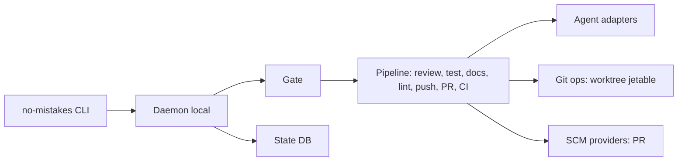

# kunchenguid/no-mistakes

> Local git proxy that validates a branch through a pipeline of AI agents before opening a clean pull request.

## The problem
Branches written quickly, often by a coding agent, arrive in review with bugs, missing tests and poorly written PRs.

## What it actually does
You push to the `no-mistakes` remote instead of `origin`. It creates a disposable worktree and chains review, test, docs, lint, push, PR and then CI monitoring, automatically fixing the safe cases and escalating the others to a human. It works with several agents (claude, codex, opencode, cursor, etc.) and provides a `/no-mistakes` skill. A local daemon, a state database and a TUI handle run tracking.

## How it is wired


## Trying it
```bash
curl -fsSL https://raw.githubusercontent.com/kunchenguid/no-mistakes/main/docs/install.sh | sh
no-mistakes init
git push no-mistakes
no-mistakes
```

## Cost and gotchas
The pipeline requires a configured agent and consumes its quota or API key; the README states that `make e2e-record` spends real credits. Installation is done via `curl | sh`. The architecture described from the code mentions a telemetry module.

## What it is not
It is not a replacement for human review: changes touching intent are escalated. Nor does it replace a CI.

## Alternatives
No alternative named in the README.

## For you
Watch: useful if you have agents write code, but a five-month-old project, run by one person, with telemetry and a quota cost to measure before adoption.
