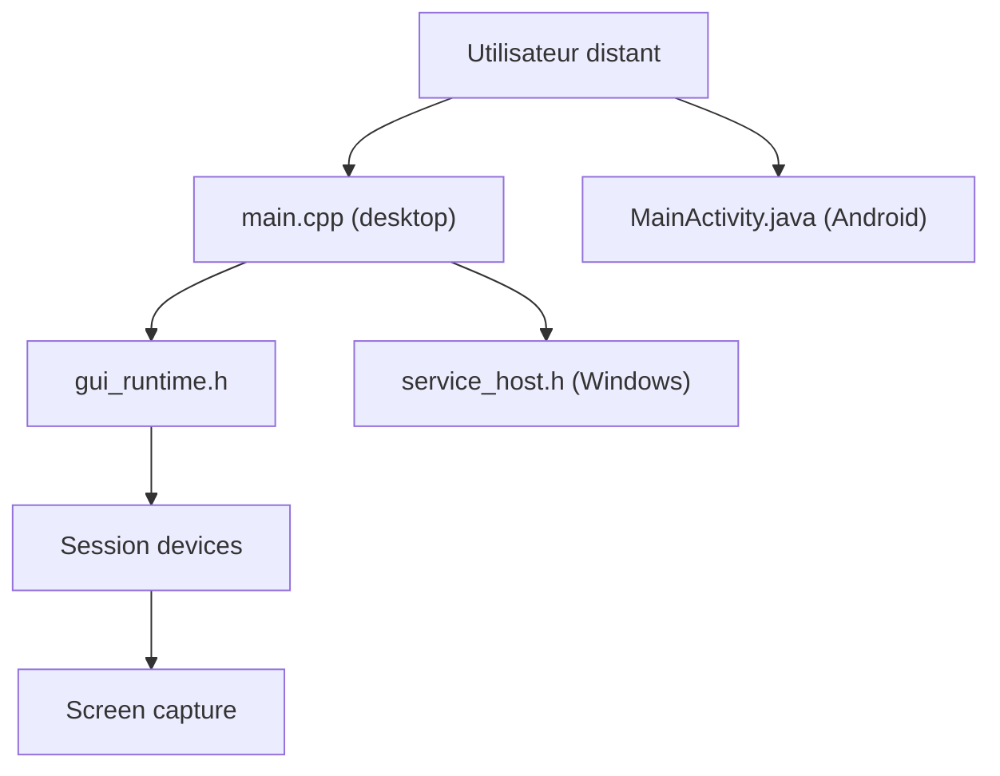

# kunkundi/crossdesk

> Cross-platform remote desktop, with a multi-machine wall, a terminal CLI and an MCP server for agents.

## The problem
Remotely controlling one or several computers without depending on a closed service, including from an AI agent.

## What it actually does
Connection by ID and password or by direct IP on Windows, macOS, Linux, iOS, Android, browser and terminal. H.264 or AV1 video, audio, clipboard, file transfer, a machine wall with grouped control. An MCP server lets an agent watch and drive a machine, with manual takeover. Self-hostable signaling and TURN, optional trusted devices.

## How it is wired


## Trying it
```bash
git clone --recurse-submodules https://github.com/kunkundi/crossdesk.git
npm install -g @chunkdash/crossdesk-cli@latest
crossdesk-cli doctor --json
crossdesk-cli 123456789
```

## Cost and gotchas
Free, funded by donations. The CLI is a development version (Node 22) and supports neither direct IP, nor audio, nor files. On macOS, screen recording and accessibility permissions. License GPL-3.0-only according to the README, not identified by GitHub.

## What it is not
Neither a monitoring tool nor a VPN. The MCP part is a development version, and the agent has real access to the remote machine.

## Alternatives
No alternative named in the README.

## For you
Worth watching: the MCP agent angle on a remote machine is interesting, but the project is run by a single person and the MCP is in development.
