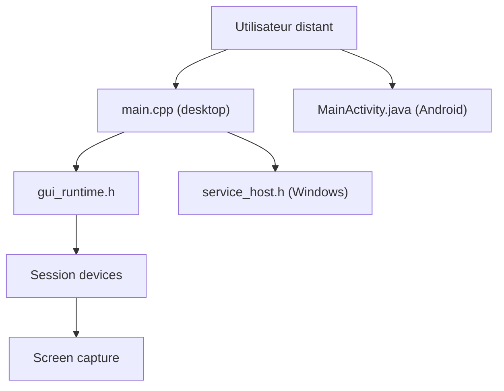

# kunkundi/crossdesk

> Bureau à distance multiplateforme, avec mur multi-postes, CLI terminal et serveur MCP pour agents.

## Le problème
Contrôler à distance un ou plusieurs ordinateurs sans dépendre d'un service fermé, y compris depuis un agent IA.

## Ce que ça fait vraiment
Connexion par identifiant et mot de passe ou par IP directe sur Windows, macOS, Linux, iOS, Android, navigateur et terminal. Vidéo H.264 ou AV1, audio, presse-papiers, transfert de fichiers, mur de postes avec contrôle groupé. Un serveur MCP laisse un agent regarder et piloter un poste, avec reprise manuelle. Signalisation et TURN auto-hébergeables, option d'appareils de confiance.

## Comment c'est branché


## Essayer
```bash
git clone --recurse-submodules https://github.com/kunkundi/crossdesk.git
npm install -g @chunkdash/crossdesk-cli@latest
crossdesk-cli doctor --json
crossdesk-cli 123456789
```

## Coût et pièges
Gratuit, financé par dons. Le CLI est une version de développement (Node 22) et ne gère ni IP directe, ni audio, ni fichiers. Sous macOS, permissions d'enregistrement d'écran et d'accessibilité. Licence GPL-3.0-only d'après le README, non identifiée par GitHub.

## Ce que ce n'est pas
Ni un outil de supervision ni un VPN. La partie MCP est une version de développement, et l'agent a un accès réel à la machine distante.

## Alternatives
Aucune alternative nommée dans le README.

## Pour toi
À surveiller : l'angle agent MCP sur un poste distant est intéressant, mais le projet est mené par une seule personne et le MCP est en développement.

