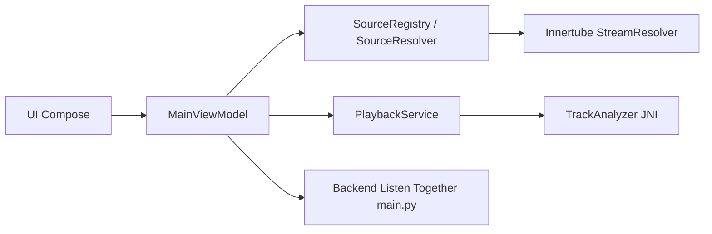

# kushagrasinghx/BitChord

> Alternative Android client for YouTube Music, with crossfade, synchronized lyrics and pluggable sources.

## The problem
Official music streaming clients offer few options for playback, lyrics and sources.

## What it actually does
Native Android application (Kotlin, Compose): YouTube Music playback via Innertube, sources through modules, local library, offline downloads, gapless and crossfade, Automix with tempo analysis by ONNX models in C++/JNI, word-by-word lyrics, Discord, Last.fm/ListenBrainz scrobbling. A small Python backend coordinates "Listen Together".

## How it is wired


## Trying it
```bash
# Aucune commande dans le README :
# télécharger l'APK signé depuis la page Releases
```

## Cost and gotchas
Free, but installation goes through sideloading an APK. The project is not affiliated with YouTube or Google and its use is the user's responsibility.

## What it is not
Not a streaming service; it depends on YouTube Music and third-party sources whose rules may change.

## Alternatives
- No alternative named in the README.

## For you
Ignore: a consumer music player, off-topic for data/AI; the embedded audio analysis is its only notable technical point.
