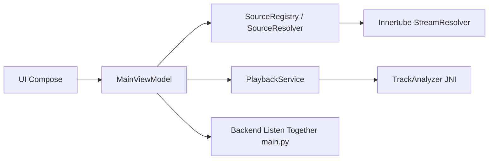

# kushagrasinghx/BitChord

> Client Android alternatif pour YouTube Music, avec fondu enchaîné, paroles synchronisées et sources enfichables.

## Le problème
Les clients officiels de streaming musical offrent peu de réglages de lecture, de paroles et de sources.

## Ce que ça fait vraiment
Application Android native (Kotlin, Compose) : lecture YouTube Music via Innertube, sources par modules, bibliothèque locale, téléchargements hors ligne, gapless et crossfade, Automix avec analyse des tempos par modèles ONNX en C++/JNI, paroles mot à mot, Discord, scrobbling Last.fm/ListenBrainz. Un petit backend Python coordonne « Listen Together ».

## Comment c'est branché


## Essayer
```bash
# Aucune commande dans le README :
# télécharger l'APK signé depuis la page Releases
```

## Coût et pièges
Gratuit, mais l'installation passe par un sideloading d'APK. Le projet n'est pas affilié à YouTube ou Google et son usage relève de la responsabilité de l'utilisateur.

## Ce que ce n'est pas
Pas un service de streaming ; il dépend de YouTube Music et de sources tierces dont les règles peuvent changer.

## Alternatives
- Aucune alternative nommée dans le README.

## Pour toi
À ignorer : lecteur musical grand public, hors sujet data/IA ; l'analyse audio embarquée est son seul point technique notable.

