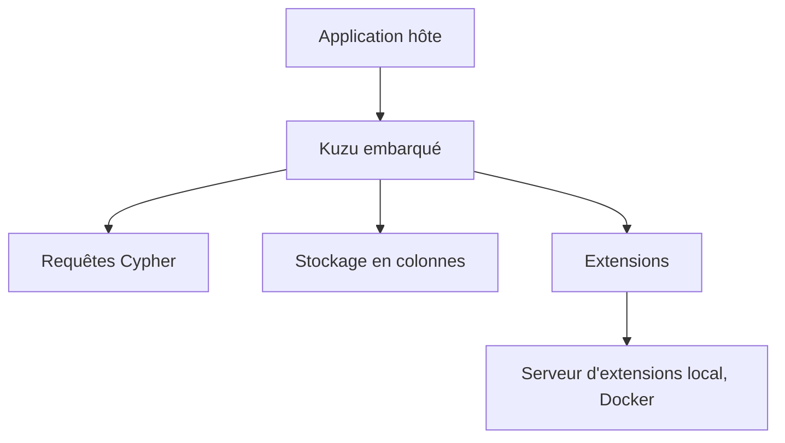

# kuzudb/kuzu

> Embedded graph database, with full-text search and vector index, for analytical queries in Cypher.

## The problem
Querying large property graphs forces you to deploy a separate database server, heavy to embed in an application.

## What it actually does
Kuzu integrates directly into the application, with no server. It stores data by columns, runs Cypher queries in parallel, offers ACID transactions, full-text search, a vector index and Wasm bindings. Since version 0.11.3, the `algo`, `fts`, `json` and `vector` extensions are preinstalled.

## How it is wired
Simplified diagram based on the sheet, no diagram provided.


## Trying it
```bash
docker pull ghcr.io/kuzudb/extension-repo:latest
docker run -d -p 8080:80 ghcr.io/kuzudb/extension-repo:latest
```
Then, in Kuzu: `INSTALL <EXTENSION_NAME> FROM 'http://localhost:8080/';`

## Cost and gotchas
Free. The repository is archived: the team is "working on something new" and no longer hosts an official extension server. Beyond 0.11.3, you must host the extensions yourself.

## What it is not
It is not a maintained project: past versions remain usable, nothing more. The installation commands for the engine itself do not appear in this README.

## Alternatives
No alternative named in the README.

## For you
Watch: an embedded graph with a vector index serves GraphRAG, but the archiving means you must follow any forks before making a choice.
