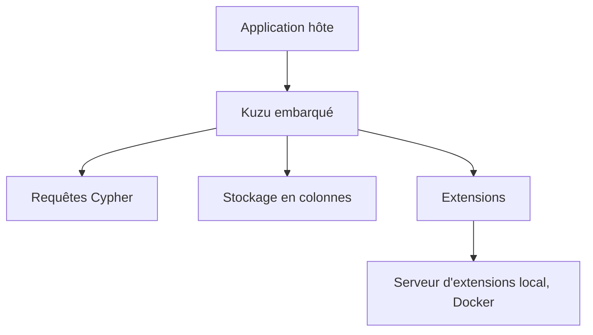

# kuzudb/kuzu

> Base de données graphe embarquée, avec recherche plein texte et index vectoriel, pour requêtes analytiques en Cypher.

## Le problème
Interroger de gros graphes de propriétés oblige à déployer un serveur de base de données séparé, lourd à embarquer dans une application.

## Ce que ça fait vraiment
Kuzu s'intègre directement dans l'application, sans serveur. Il stocke par colonnes, exécute les requêtes Cypher en parallèle, offre des transactions ACID, une recherche plein texte, un index vectoriel et des bindings Wasm. Depuis la version 0.11.3, les extensions `algo`, `fts`, `json` et `vector` sont préinstallées.

## Comment c'est branché
Schéma simplifié d'après la fiche, sans diagramme fourni.


## Essayer
```bash
docker pull ghcr.io/kuzudb/extension-repo:latest
docker run -d -p 8080:80 ghcr.io/kuzudb/extension-repo:latest
```
Puis, dans Kuzu : `INSTALL <EXTENSION_NAME> FROM 'http://localhost:8080/';`

## Coût et pièges
Gratuit. Le dépôt est archivé : l'équipe « travaille sur quelque chose de nouveau » et n'héberge plus de serveur d'extensions officiel. Au-delà de la 0.11.3, il faut héberger soi-même les extensions.

## Ce que ce n'est pas
Ce n'est pas un projet maintenu : les versions passées restent utilisables, rien de plus. Les commandes d'installation du moteur lui-même ne figurent pas dans ce README.

## Alternatives
Aucune alternative nommée dans le README.

## Pour toi
À surveiller : un graphe embarqué avec index vectoriel sert le GraphRAG, mais l'archivage impose de suivre d'éventuels forks avant tout choix.

