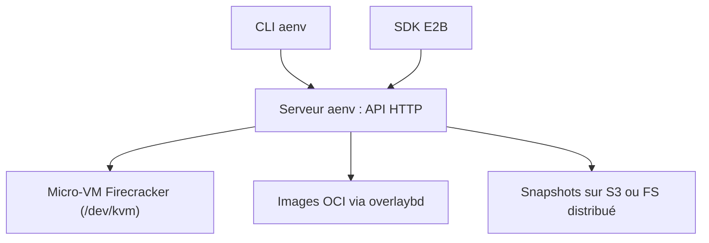

# kvcache-ai/AgentENV

> Large-scale Firecracker sandbox platform for training agents with reinforcement learning.

## The problem
Training agents requires thousands of isolated environments, started quickly, paused and cloned at low memory cost.

## What it actually does
Runs Firecracker micro-VMs with OCI images loaded on demand (overlaybd). Environments start or resume in under 50 ms (according to the README), with incremental memory and disk snapshots and cloning into parallel sandboxes. It exposes an E2B-compatible API and an `aenv` CLI. The README says it serves the training of Kimi K3.

## How it is wired
Simplified diagram based on the sheet, no diagram provided.



## Trying it
```bash
curl -fsSL https://raw.githubusercontent.com/kvcache-ai/AgentENV/main/scripts/install.sh | sudo bash
sudo systemctl start aenv
aenv auth
aenv pull ubuntu:22.04 --name ubuntu
aenv start ubuntu
```

## Cost and gotchas
Free, but requires Linux 6.8+ and `/dev/kvm`. The Docker container runs with `--privileged`. API traffic is not encrypted: put it behind HTTPS.

## What it is not
Not a managed service: you host and administer the machines. The performance figures are the README's, not verified here.

## Alternatives
- E2B: the API is compatible with its Python and TypeScript SDKs.

## For you
Worth watching: relevant if you are building an agent training infrastructure on your own hardware; too heavy (kernel, KVM, privileges) for simple experiments.
