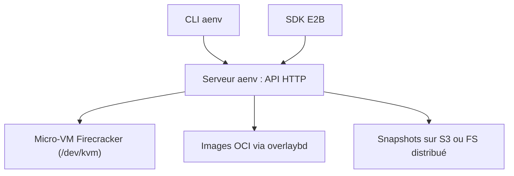

# kvcache-ai/AgentENV

> Plateforme de bacs à sable Firecracker à grande échelle, pour l'entraînement d'agents par apprentissage par renforcement.

## Le problème
L'entraînement d'agents exige des milliers d'environnements isolés, démarrés vite, mis en pause et clonés à faible coût mémoire.

## Ce que ça fait vraiment
Fait tourner des micro-VM Firecracker avec images OCI chargées à la demande (overlaybd). Les environnements démarrent ou reprennent en moins de 50 ms (selon le README), avec snapshots mémoire et disque incrémentaux et clonage en sandbox parallèles. Il expose une API compatible E2B et un CLI `aenv`. Le README dit servir l'entraînement de Kimi K3.

## Comment c'est branché
Schéma simplifié d'après la fiche, sans diagramme fourni.



## Essayer
```bash
curl -fsSL https://raw.githubusercontent.com/kvcache-ai/AgentENV/main/scripts/install.sh | sudo bash
sudo systemctl start aenv
aenv auth
aenv pull ubuntu:22.04 --name ubuntu
aenv start ubuntu
```

## Coût et pièges
Gratuit, mais exige Linux 6.8+ et `/dev/kvm`. Le conteneur Docker tourne en `--privileged`. Le trafic API n'est pas chiffré : à placer derrière HTTPS.

## Ce que ce n'est pas
Pas un service géré : tu héberges et administres les machines. Les chiffres de performance sont ceux du README, non vérifiés ici.

## Alternatives
- E2B : l'API est compatible avec ses SDK Python et TypeScript.

## Pour toi
À surveiller : pertinent si tu montes une infrastructure d'entraînement d'agents sur ton propre matériel ; trop lourd (noyau, KVM, privilèges) pour de simples essais.

