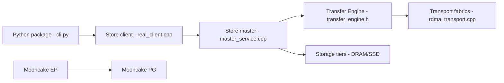

# kvcache-ai/Mooncake

> LLM serving infrastructure centered on the KV cache, for large-scale inference teams.

## The problem
LLM prefill and decoding saturate GPUs, and KV caches are not shared between instances.

## What it actually does
Three building blocks: Transfer Engine (batched transfers over TCP, RDMA, EFA, NVLink, CXL…), Mooncake Store (distributed KV cache and weights, DRAM/SSD, metadata master, high availability via etcd/Redis/Kubernetes) and EP/PG (fault-tolerant expert parallelism, PyTorch backend). Integrated with SGLang, vLLM, TensorRT-LLM, LMCache, etc. The README claims 87 and 190 GB/s on RoCE according to its own measurements.

## How it is wired


## Trying it
```bash
pip install mooncake-transfer-engine
pip install mooncake-transfer-engine-cuda13
```
(the first for CUDA < 13.0, the second for CUDA ≥ 13.0).

## Cost and gotchas
Requires GPU cluster hardware, ideally an RDMA network; external dependencies depending on the mode (etcd, Redis, S3). 823 open issues.

## What it is not
Not an inference engine: it plugs in underneath SGLang or vLLM.

## Alternatives
NIXL, LMCache and FlexKV are cited as neighboring projects or integrations.

## For you
Worth watching: relevant if you operate distributed inference; oversized for a single GPU.
