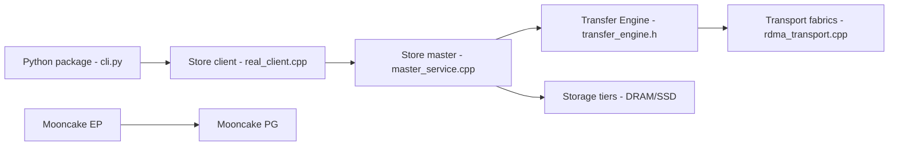

# kvcache-ai/Mooncake

> Infrastructure de service LLM centrée sur le cache KV, pour équipes d'inférence à grande échelle.

## Le problème
Le préremplissage et le décodage d'un LLM saturent les GPU, et les caches KV ne sont pas partagés entre instances.

## Ce que ça fait vraiment
Trois briques : Transfer Engine (transferts par lots TCP, RDMA, EFA, NVLink, CXL…), Mooncake Store (cache KV et poids distribué, DRAM/SSD, maître de métadonnées, haute disponibilité via etcd/Redis/Kubernetes) et EP/PG (parallélisme d'experts tolérant aux pannes, backend PyTorch). Intégré à SGLang, vLLM, TensorRT-LLM, LMCache, etc. Le README annonce 87 et 190 Go/s sur RoCE selon ses mesures.

## Comment c'est branché


## Essayer
```bash
pip install mooncake-transfer-engine
pip install mooncake-transfer-engine-cuda13
```
(première pour CUDA < 13.0, seconde pour CUDA ≥ 13.0).

## Coût et pièges
Nécessite du matériel de grappe GPU, idéalement réseau RDMA ; dépendances externes selon le mode (etcd, Redis, S3). 823 issues ouvertes.

## Ce que ce n'est pas
Pas un moteur d'inférence : il se branche sous SGLang ou vLLM.

## Alternatives
NIXL, LMCache, FlexKV sont cités comme projets voisins ou intégrations.

## Pour toi
À surveiller : pertinent si tu opères de l'inférence distribuée ; surdimensionné pour un seul GPU.

