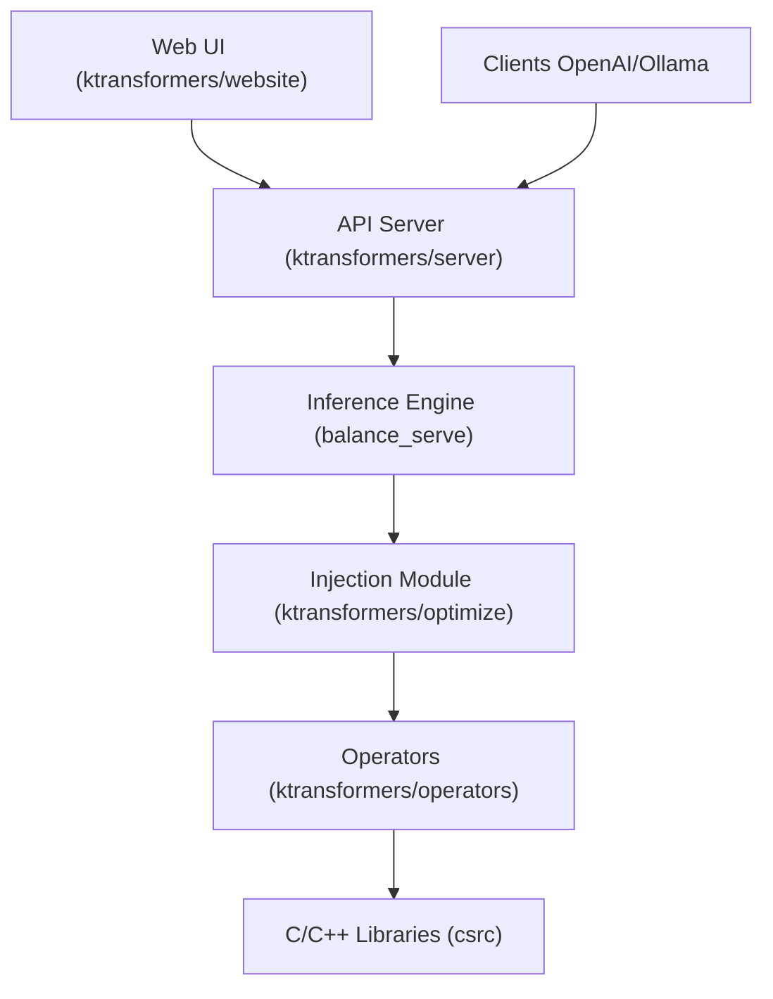

# kvcache-ai/ktransformers

> CPU-GPU kernels for running or fine-tuning large MoE models on limited hardware.

## The problem
Very large MoE models (DeepSeek-V3/R1, Kimi K2.5) exceed the GPU memory of an ordinary machine, whether for inference or fine-tuning.

## What it actually does
Two capabilities from the `kt-kernel` tree: hybrid inference (AMX/AVX512 CPU kernels, "hot" experts on GPU, "cold" ones on CPU, SGLang integration) and SFT fine-tuning via LlamaFactory with LoRA. The README claims 6 to 12 times the speed of ZeRO-Offload on MoE workloads measured by the authors. The former integrated framework is archived in `archive/`.

## How it is wired

The diagram describes the old integrated architecture; the current README points to `kt-kernel`.

## Trying it
```bash
cd kt-kernel
pip install .
```
```bash
python -m pip install "ktransformers[sft]==0.7.0"
python -m pip install "sglang-kt==0.7.0"
```

## Cost and gotchas
Demanding hardware: the examples cite 4 RTX 4090 (~80 GB) for DeepSeek-V3, or 8 L20 with a Xeon for inference. AMX kernels assume a recent Intel CPU and a lot of RAM.

## What it is not
Not a turnkey tool for a laptop: the figures come from servers. A research project (two papers cited), whose documentation was recently reorganized.

## Alternatives
LlamaFactory and SGLang are named complements, not competitors.

## For you
Worth watching: useful if you have a big CPU+GPU server and MoE models to fine-tune, otherwise out of hardware reach.
