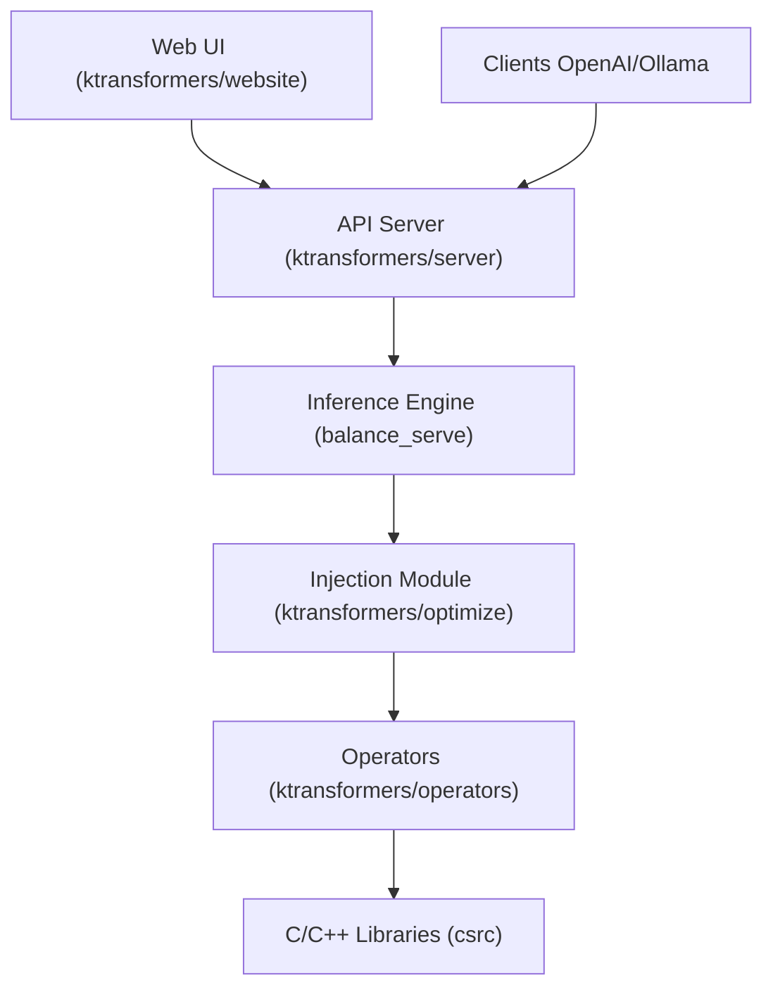

# kvcache-ai/ktransformers

> Noyaux CPU-GPU pour faire tourner ou affiner de gros modèles MoE sur du matériel limité.

## Le problème
Les très gros modèles MoE (DeepSeek-V3/R1, Kimi K2.5) dépassent la mémoire GPU d'une machine ordinaire, que ce soit en inférence ou en fine-tuning.

## Ce que ça fait vraiment
Deux capacités depuis l'arbre `kt-kernel` : l'inférence hybride (noyaux CPU AMX/AVX512, experts « chauds » sur GPU, « froids » sur CPU, intégration SGLang) et le fine-tuning SFT via LlamaFactory avec LoRA. Le README annonce 6 à 12 fois plus de vitesse que ZeRO-Offload sur des charges MoE mesurées chez eux. L'ancien framework intégré est archivé dans `archive/`.

## Comment c'est branché

Le diagramme décrit l'ancienne architecture intégrée ; le README actuel pointe vers `kt-kernel`.

## Essayer
```bash
cd kt-kernel
pip install .
```
```bash
python -m pip install "ktransformers[sft]==0.7.0"
python -m pip install "sglang-kt==0.7.0"
```

## Coût et pièges
Matériel exigeant : les exemples citent 4 RTX 4090 (~80 Go) pour DeepSeek-V3, ou 8 L20 avec un Xeon pour l'inférence. Les noyaux AMX supposent un CPU Intel récent et beaucoup de RAM.

## Ce que ce n'est pas
Pas un outil clé en main pour portable : les chiffres viennent de serveurs. Projet de recherche (deux articles cités), dont la documentation a été réorganisée récemment.

## Alternatives
LlamaFactory et SGLang sont des compléments nommés, pas des concurrents.

## Pour toi
À surveiller : utile si tu as un gros serveur CPU+GPU et des MoE à affiner, sinon hors de portée matérielle.

