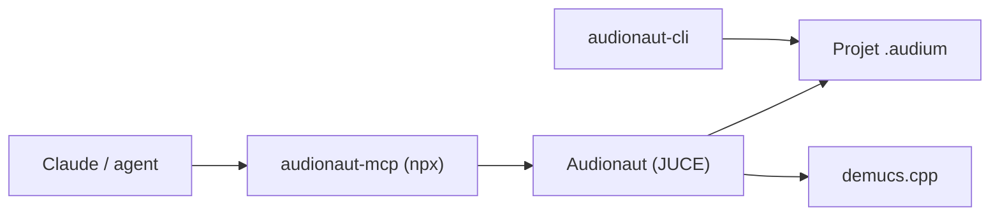

# kvoltmer/Audionaut

> Open-source multitrack audio editor in C++/JUCE, drivable by AI agents through MCP.

## The problem
Editing recordings often requires heavy studio software, and an AI agent cannot drive those tools cleanly.

## What it actually does
- Precise cutting, per-track playlists, multichannel, clean export; Windows, macOS and Linux.
- Built-in analysis: segments, beats with tempo, attack detection.
- Track separation (drums, bass, vocals, other) with demucs.cpp; the model weights are downloaded on first use.
- An MCP server (`audionaut-mcp`) and a CLI `audionaut-cli` with JSON output, for agents and CI.

## How it is wired
Simplified diagram based on the sheet, no diagram provided.


## Trying it
```bash
claude mcp add audionaut -- npx -y audionaut-mcp
git clone --recursive https://github.com/kvoltmer/Audionaut.git
audionaut-cli create song.audium --channels 2
audionaut-cli export song.audium -o mix.wav --sample-rate 48000 --bit-depth 24
```

## Cost and gotchas
Free. Node 18 or later for the MCP server. Clone with `--recursive` (submodules). Anonymous usage statistics are sent only with consent; `AUDIONAUT_DISABLE_ANALYTICS=1` turns them off on the CLI side. A license is present but not identified by GitHub.

## What it is not
Not a full DAW: the README says it aims for a tool without the weight of an audio workstation. The sandboxed macOS app only reaches certain folders such as `~/Music`.

## Alternatives
No alternative cited in the README.

## For you
Worth watching as an example of software exposed to an agent via MCP and a JSON CLI; useful only if you work with audio.
