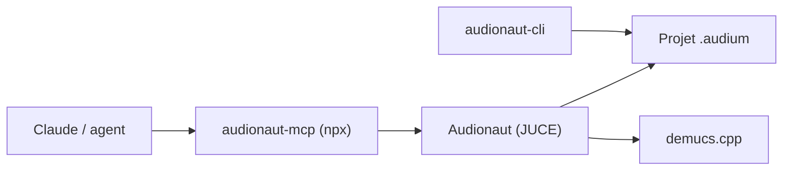

# kvoltmer/Audionaut

> Éditeur audio multipistes libre en C++/JUCE, pilotable par des agents IA via MCP.

## Le problème
Éditer des enregistrements demande souvent un logiciel de studio lourd, et un agent IA ne peut pas piloter ces outils proprement.

## Ce que ça fait vraiment
- Découpe précise, playlists par piste, multicanal, export propre ; Windows, macOS et Linux.
- Analyse intégrée : segments, battues avec tempo, détection d'attaques.
- Séparation de pistes (batterie, basse, voix, autres) avec demucs.cpp ; les poids du modèle sont téléchargés au premier usage.
- Un serveur MCP (`audionaut-mcp`) et une CLI `audionaut-cli` avec sortie JSON, pour agents et CI.

## Comment c'est branché
Schéma simplifié d'après la fiche, sans diagramme fourni.


## Essayer
```bash
claude mcp add audionaut -- npx -y audionaut-mcp
git clone --recursive https://github.com/kvoltmer/Audionaut.git
audionaut-cli create song.audium --channels 2
audionaut-cli export song.audium -o mix.wav --sample-rate 48000 --bit-depth 24
```

## Coût et pièges
Gratuit. Node 18 ou plus pour le serveur MCP. Cloner avec `--recursive` (sous-modules). Statistiques d'usage anonymes envoyées seulement avec consentement ; `AUDIONAUT_DISABLE_ANALYTICS=1` les coupe côté CLI. Licence présente mais non identifiée par GitHub.

## Ce que ce n'est pas
Pas un DAW complet : le README dit viser un outil sans le poids d'une station de travail audio. L'app macOS sandboxée n'atteint que certains dossiers comme `~/Music`.

## Alternatives
Aucune alternative citée dans le README.

## Pour toi
À surveiller comme exemple de logiciel exposé à un agent par MCP et CLI JSON ; utile seulement si tu traites de l'audio.

