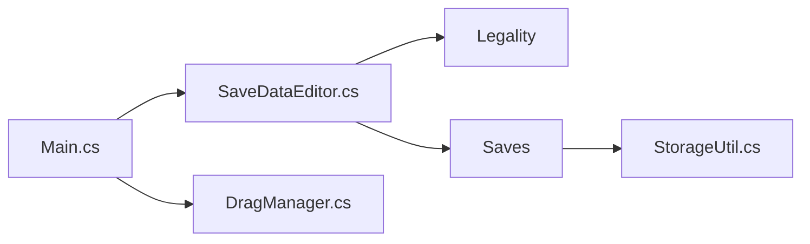

# kwsch/PKHeX

> Pokémon save editor in C#, for players and romhackers.

## The problem
Editing, converting and checking the legality of Pokémon saves and files across generations.

## What it actually does
Opens saves, entities, mystery gifts, GameCube memory cards. Edits, converts, checks legality, imports/exports Showdown sets and QR codes. Windows Forms application, .NET 10, C# 14.

## How it is wired

## Trying it
The README says to open the `.sln` or `.csproj` in an IDE (e.g. Visual Studio); no command is provided.

## Cost and gotchas
Free. Expects saves not encrypted by the console. The license exists but is not identified by GitHub.

## What it is not
Not a tool for playing online: the README discourages cheating.

## Alternatives
No alternative cited in the README.

## For you
Ignore: game tool unrelated to data / AI / MLOps.
