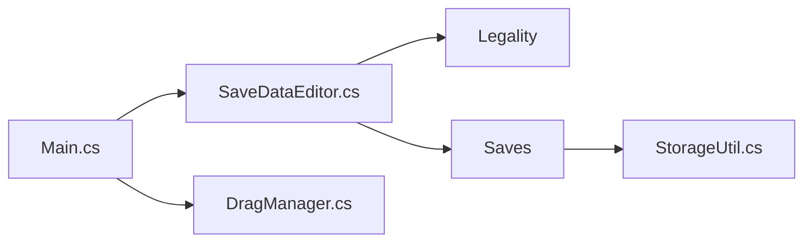

# kwsch/PKHeX

> Éditeur de sauvegardes Pokémon en C#, pour joueurs et romhackers.

## Le problème
Modifier, convertir et vérifier la légalité de sauvegardes et fichiers Pokémon entre générations.

## Ce que ça fait vraiment
Ouvre sauvegardes, entités, cadeaux mystère, cartes mémoire GameCube. Édite, convertit, vérifie la légalité, importe/exporte sets Showdown et QR codes. Application Windows Forms, .NET 10, C# 14.

## Comment c'est branché

## Essayer
Le README indique d'ouvrir le `.sln` ou `.csproj` dans un IDE (ex. Visual Studio) ; aucune commande n'est fournie.

## Coût et pièges
Gratuit. Attend des sauvegardes non chiffrées par la console. La licence existe mais n'est pas identifiée par GitHub.

## Ce que ce n'est pas
Pas un outil pour jouer en ligne : le README déconseille la triche.

## Alternatives
Aucune alternative citée dans le README.

## Pour toi
À ignorer : outil de jeu sans rapport avec data / IA / MLOps.

