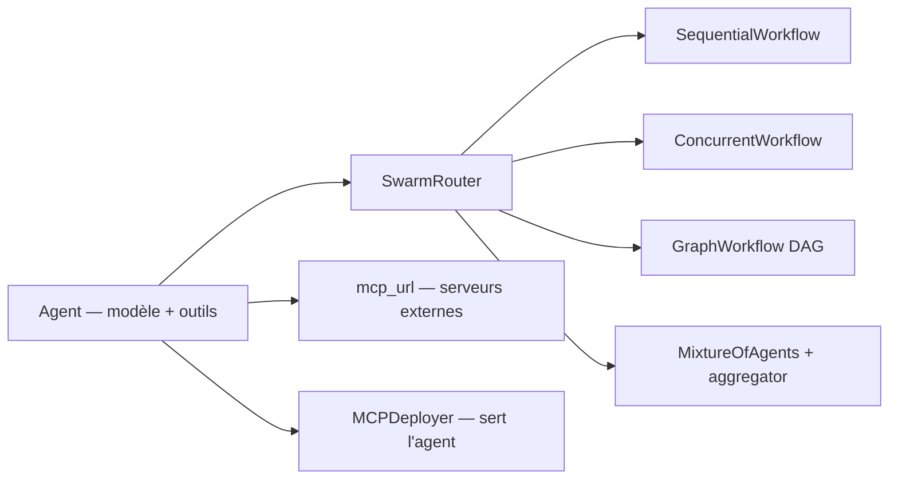

# kyegomez/swarms

> Python multi-agent orchestration framework with around sixty prebuilt architectures.

## The problem
Going from a single agent to several coordinated agents means rewriting the same plumbing every time:
context passing, parallel execution, aggregation, dependencies between steps.

## What it actually does
An `Agent` object (model + tools + memory), and structures to assemble them.
`SequentialWorkflow` chains, `ConcurrentWorkflow` parallelizes, `AgentRearrange` describes the
relationships with an `einsum`-style string, `GraphWorkflow` runs a DAG with topological sorting and
automatic parallelism for independent branches, `MixtureOfAgents` converges experts onto an
aggregator, `GroupChat` lets each agent decide whether to speak, `HierarchicalSwarm` puts a director
above workers. `SwarmRouter` gives a single interface: changing `swarm_type` is enough. On the MCP
side, an agent consumes servers via `mcp_url`, and `MCPDeployer` turns an agent or a swarm into an
authenticated MCP server.

## How it is wired


## Trying it
```bash
pip3 install -U swarms
uv pip install swarms
poetry add swarms
git clone https://github.com/kyegomez/swarms.git
pip install -r requirements.txt
```

## Cost and gotchas
The framework is free, the models are not: each agent consumes tokens, and `max_loops="auto"` lets
the agent decide for itself when to stop — the README explicitly recommends a fixed value for
pipelines sensitive to cost or latency. An `MCPDeployer` server without authentication refuses to
start unless `allow_anonymous=True`. `GroupChat` requires giving `RESPOND_TOOL` to each agent.

## What it is not
The README is very promotional: "the most reliable", "enterprise-grade", with no measurements to
back it up. The repository belongs to one person, which weighs on an infrastructure component. The
README is truncated before the end. The Docker section is commented out, so it is not supported.

## Alternatives
No alternative is named in the README; it only claims backward compatibility with other agent
frameworks.

## For you
A good catalogue of patterns to read; be wary of depending on it in production given the governance.
