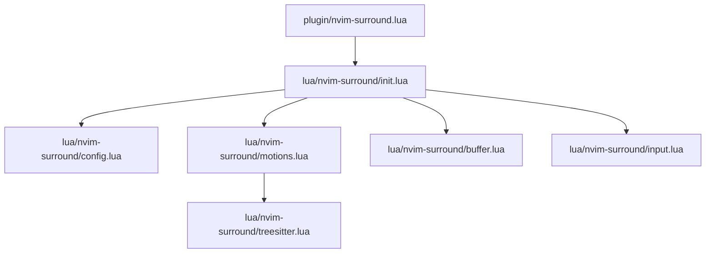

# kylechui/nvim-surround

> Neovim plugin to add, delete and change the pairs surrounding a selection.

## The problem
Wrapping text in quotes, parentheses or tags, or changing those delimiters, is tedious by hand.

## What it actually does
Three operations: `ys{motion}{char}` adds, `ds{char}` deletes, `cs{target}{replacement}` changes. It handles function calls and HTML tags, dot repeat, buffer-local pairs, aliases such as `q` for quotes, and targets by motion, Lua pattern or Tree-sitter node. The selection is highlighted.

## How it is wired
Diagram based on the one provided.



## Trying it
```lua
-- lazy.nvim
{
    "kylechui/nvim-surround",
    version = "^4.0.0",
    event = "VeryLazy",
}
```

## Cost and gotchas
Free. Neovim 0.8+. Installing via `vim.pack` requires Neovim 0.12. Tree-sitter textobjects optional but recommended.

## What it is not
Not a commenting or general editing plugin: it only handles delimiters.

## Alternatives
- vim-surround: the original.
- mini.surround: same role.
- vim-sandwich: same role.

## For you
Worth watching: if you live in Neovim, it removes a lot of keystrokes on Python or Markdown; a single maintainer remains a minor risk.
