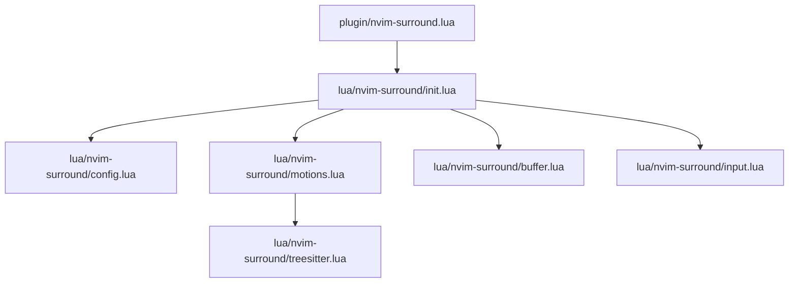

# kylechui/nvim-surround

> Plugin Neovim pour ajouter, supprimer et changer les paires qui entourent une sélection.

## Le problème
Entourer un texte de guillemets, parenthèses ou balises, ou changer ces délimiteurs, est fastidieux à la main.

## Ce que ça fait vraiment
Trois opérations : `ys{motion}{char}` ajoute, `ds{char}` supprime, `cs{cible}{remplacement}` change. Il gère les appels de fonction et les balises HTML, la répétition par point, des paires locales au buffer, des alias comme `q` pour les guillemets, et les cibles par motion, motif Lua ou nœud Tree-sitter. La sélection est surlignée.

## Comment c'est branché
Schéma d'après le diagramme fourni.



## Essayer
```lua
-- lazy.nvim
{
    "kylechui/nvim-surround",
    version = "^4.0.0",
    event = "VeryLazy",
}
```

## Coût et pièges
Gratuit. Neovim 0.8+. L'installation par `vim.pack` exige Neovim 0.12. Tree-sitter textobjects facultatif mais conseillé.

## Ce que ce n'est pas
Pas un plugin de commentaire ni d'édition générale : il ne gère que les délimiteurs.

## Alternatives
- vim-surround : l'original.
- mini.surround : même rôle.
- vim-sandwich : même rôle.

## Pour toi
À surveiller : si tu vis dans Neovim, il enlève beaucoup de gestes sur du Python ou du Markdown ; un mainteneur unique reste un risque mineur.

