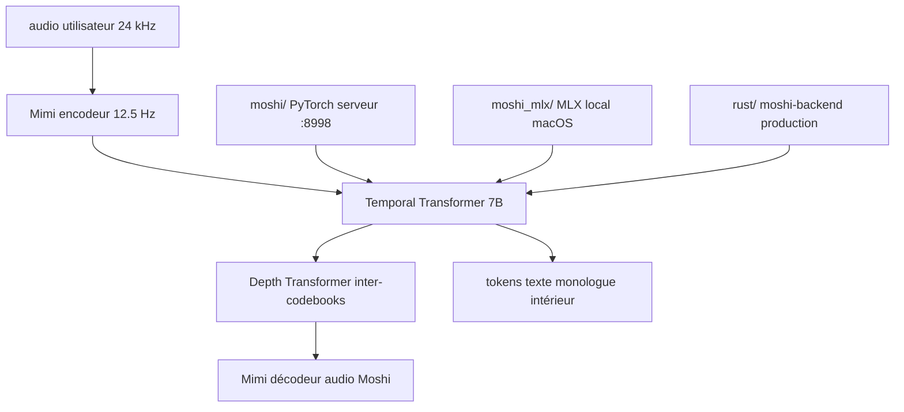

# kyutai-labs/moshi

> Full-duplex speech-text model for real-time dialogue, with the streaming audio codec Mimi.

## The problem
A voice assistant assembled as ASR then LLM then TTS speaks one turn at a time and accumulates latency.
Existing neural codecs are not streaming, which rules out real time.

## What it actually does
Models two audio streams — Moshi's and the user's — and in parallel predicts the text tokens of its own speech, its "inner monologue".
A small Depth Transformer handles dependencies between codebooks, a 7-billion-parameter Temporal Transformer handles time; theoretical latency 160 ms, about 200 ms in practice on an L4 GPU.
Mimi encodes 24 kHz to 12.5 Hz at 1.1 kbps in streaming (80 ms latency), with a Transformer in the encoder and decoder, a distillation loss toward WavLM and adversarial-only training.
Three inference stacks in the repository: PyTorch (`moshi/`) for research, MLX (`moshi_mlx/`) for iPhone and Mac, Rust (`rust/`) for production, plus a web client (`client/`).

## How it is wired


## Trying it
```bash
pip install -U moshi
pip install -U moshi_mlx
pip install rustymimi
python -m moshi.server [--gradio-tunnel] [--hf-repo kyutai/moshika-pytorch-bf16]
python -m moshi.client [--url URL_TO_GRADIO]
python -m moshi_mlx.local -q 4
cargo run --features cuda --bin moshi-backend -r -- --config moshi-backend/config.json standalone
docker compose up
```

## Cost and gotchas
Models under CC-BY 4.0, free. In PyTorch there is no quantization: you need a GPU of about 24 GB. Python 3.10 minimum, 3.12 recommended — otherwise you need the Rust toolchain to install `rustymimi`.
A remote server over HTTP blocks the microphone in the browser: you must forward port 8998 over SSH or use `--gradio-tunnel`, which adds up to 500 ms from Europe. Windows is not officially supported.

## What it is not
Not a ready-to-use assistant: the CLI clients are minimal, with no echo cancellation or delay compensation — the web UI is recommended.
Not a model to fine-tune here: fine-tuning lives in `kyutai-labs/moshi-finetune`.
Not a simple TTS or ASR: those are other Kyutai models, in the Delayed Streams Modeling repository.

## Alternatives
- SpeechTokenizer, SemantiCodec, SoundStream, EnCodec: codecs cited as comparison points or foundations of Mimi.
- Hibiki: simultaneous speech translation, same multi-stream architecture.

## For you
Worth watching for real-time duplex; the 24 GB of GPU in PyTorch reserves the trial for a dedicated machine.
