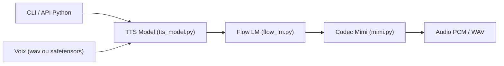

# kyutai-labs/pocket-tts

> Lightweight text-to-speech from Kyutai that runs on CPU, with voice cloning, for developers who want local TTS.

## The problem
Text-to-speech models usually require a GPU or a paid remote API.

## What it actually does
A model of about 100 million parameters, first audio chunk in ~200 ms, faster than real time on a MacBook Air M4 with two cores. Works from the command line (`generate`, `serve`, `export-voice`) and as a Python library. Six languages, cloning from a wav file, unlimited text length. The training code was released in August 2026.

## How it is wired


## Trying it
```bash
uvx pocket-tts generate
uvx pocket-tts serve
pip install pocket-tts
pip install pocket-tts --extra-index-url https://download.pytorch.org/whl/cpu
```

## Cost and gotchas
Free. On Linux, `pip install` pulls the CUDA version of PyTorch (about 3 GB) unless you use the CPU index. The weights are downloaded from Hugging Face. Cloning a voice without consent is explicitly forbidden.

## What it is not
GPU is not officially supported (no device option in `load_model`), and `serve` and the Docker image stay on CPU.

## Alternatives
The README lists ports: pocket-tts-mlx (Apple Silicon), PocketTTS.cpp, sherpa-onnx, pocket-tts-candle.

## For you
Adopt: local TTS on CPU, MIT license, one-line install; ideal for prototyping a voice assistant without a GPU or an API.
