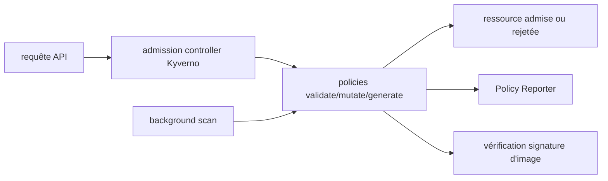

# kyverno/kyverno

> Kubernetes-native policy engine: validate, mutate, generate and clean up resources.

## The problem
Enforcing security and compliance rules on a cluster otherwise means writing custom admission webhooks, which are costly to maintain.

## What it actually does
Validates, mutates, generates and cleans up resources, through Kubernetes admission controls and background scans.
Verifies container image signatures for supply chain security.
Works with the tools already in place: `kubectl`, `kustomize`, Git.
Complements the native controls (`ValidatingAdmissionPolicies`, `MutatingAdmissionPolicies`) with reporting, exception handling and periodic scanning.

## How it is wired

## Trying it
No command is documented in the README: it points to the Quick Start and the installation guide on kyverno.io.

## Cost and gotchas
Free, a CNCF project. An admission webhook sits on the API server's critical path: a badly written policy blocks deployments. Policies must be maintained like any security product.

## What it is not
The README is explicit about its non-goals: Kyverno does not protect against flaws in Kubernetes' own design, does not replace RBAC (which handles access, whereas Kyverno handles compliance), and only enforces the rules you have written. End-to-end testing, reporting and JSON outside Kubernetes are separate projects.

## Alternatives
Chainsaw (e2e testing), Policy Reporter (reports and UI), Kyverno JSON, Kyverno Envoy Plugin — companion projects covering what the engine does not.

## For you
The standard way to impose guardrails on a shared cluster: GPU quotas, allowed images, cost-allocation labels.
