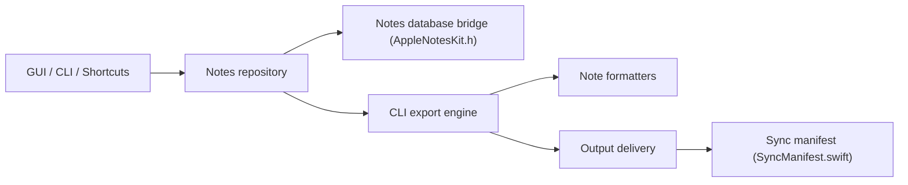

# kzaremski/apple-notes-exporter

> macOS app that bulk-exports Apple Notes to many formats, with a CLI, Shortcuts and MCP.

## The problem
Apple Notes offers no way to export the whole library while keeping folders, formatting and attachments.

## What it actually does
Reads the Notes database directly (iCloud and "On My Mac" accounts) and exports to a folder, ZIP, TAR or single file, in 18 formats (HTML, PDF, Markdown, DOCX, EPUB, JSON, JSONL, ENEX, etc.). Incremental sync through a manifest. It can be driven by a GUI, the `notes-export` CLI, five Shortcuts actions and an MCP server with six tools.

## How it is wired


## Trying it
```bash
notes-export list-accounts
notes-export export --output ~/Desktop/notes --format markdown --account iCloud
notes-export export --output ~/backups/notes --format markdown --incremental
```

## Cost and gotchas
Free. macOS Big Sur 11+, full disk access required. Notes from email accounts (Gmail, Yahoo) cannot be exported unless you move them to iCloud. The MCP export only writes under $HOME or /tmp.

## What it is not
Not a cross-platform tool nor a two-way synchronizer: it only exports. Note contents should be treated as untrusted input for an assistant.

## Alternatives
No alternative named in the README.

## For you
Worth watching: handy for feeding a RAG pipeline from your notes (JSONL), only if you are on a Mac; GPL-3.0, a single maintainer.
