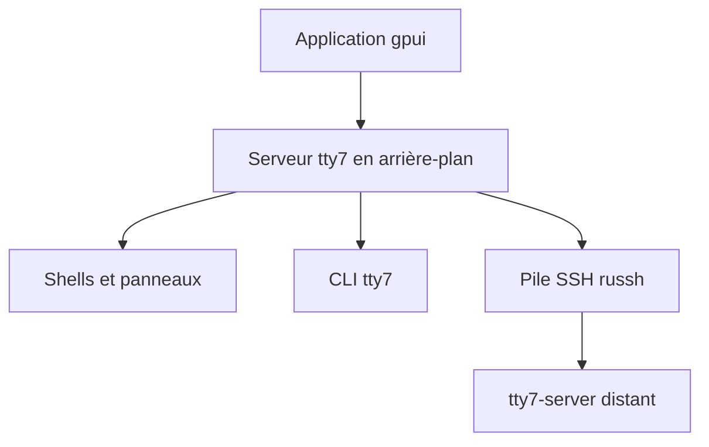

# l0ng-ai/tty7

> Graphical terminal in Rust with persistent sessions, remote work and coding-agent tracking.

## The problem
Terminal sessions die with the window, and tracking several coding agents across several repositories requires tmux and tinkering.

## What it actually does
A background server owns the shells and panes; the graphical application (Zed's gpui, Alacritty's VT core) can close without stopping them, and the layout comes back after a restart. It detects 28 agent CLIs (Claude Code, Codex), shows status, notifications, branch and diff. It provides a side panel (files, ports, diffs, GitHub issues via `gh`), a native SSH stack and a `tty7` CLI that agents can drive.

## How it is wired
Simplified diagram based on the sheet, no diagram provided.



## Trying it
```sh
npx skills add l0ng-ai/tty7
npx skills update tty7
```
Binaries are on the Releases page (dmg, setup.exe, AppImage; `chmod +x` on Linux).

## Cost and gotchas
Free. The performance figures come from an Apple M1 Pro, over five runs, by the author. The project dates from July 2026 and has 82 open issues.

## What it is not
Not a tmux-compatible multiplexer. The claimed gains (about twice the throughput) only hold for that benchmark setup.

## Alternatives
Alacritty, Ghostty and Kitty, compared in the README's performance table.

## For you
Keep an eye on it: interesting if you run several Claude Code agents in parallel and want persistent sessions, but too young to depend on.
