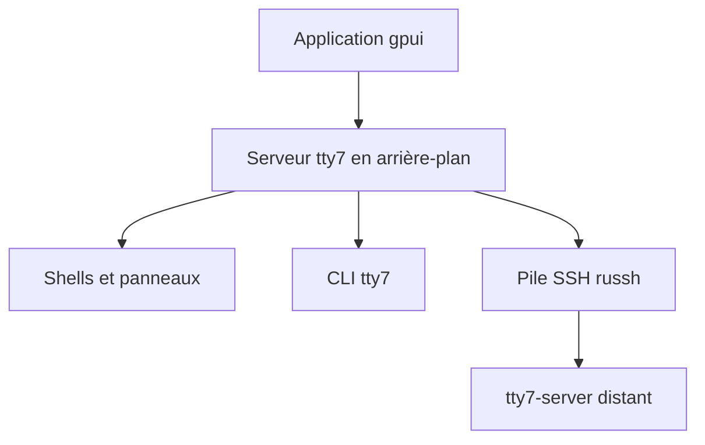

# l0ng-ai/tty7

> Terminal graphique en Rust avec sessions persistantes, travail à distance et suivi des agents de code.

## Le problème
Les sessions de terminal meurent avec la fenêtre, et suivre plusieurs agents de code sur plusieurs dépôts demande tmux et du bricolage.

## Ce que ça fait vraiment
Un serveur d'arrière-plan possède les shells et les panneaux ; l'application graphique (gpui de Zed, noyau VT d'Alacritty) peut se fermer sans les arrêter, et la disposition revient après un redémarrage. Il détecte 28 CLI d'agents (Claude Code, Codex), affiche statut, notifications, branche et diff. Il apporte un panneau latéral (fichiers, ports, diffs, issues GitHub via `gh`), une pile SSH native et une CLI `tty7` pilotable par des agents.

## Comment c'est branché
Schéma simplifié d'après la fiche, sans diagramme fourni.



## Essayer
```sh
npx skills add l0ng-ai/tty7
npx skills update tty7
```
Les binaires sont sur la page des Releases (dmg, setup.exe, AppImage ; `chmod +x` sous Linux).

## Coût et pièges
Gratuit. Les chiffres de performance viennent d'un Apple M1 Pro, sur cinq essais, par l'auteur. Le projet date de juillet 2026 et compte 82 issues ouvertes.

## Ce que ce n'est pas
Pas un multiplexeur compatible tmux. Les gains annoncés (environ deux fois plus de débit) ne valent que pour ce banc de mesure.

## Alternatives
Alacritty, Ghostty et Kitty, comparés dans le tableau de performance du README.

## Pour toi
À surveiller : intéressant si tu lances plusieurs agents Claude Code en parallèle et veux des sessions persistantes, mais trop jeune pour en dépendre.

