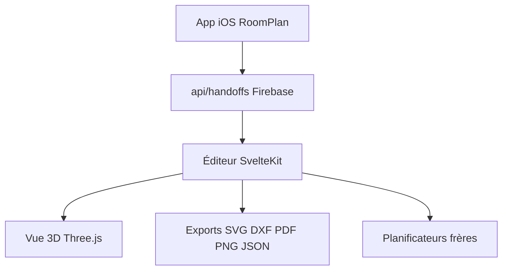

# laanlabs/openPlan3D

> 2D floor plan editor with a 3D preview in the browser, no account needed, for individuals.

## The problem
Drawing an interior plan and then viewing it in 3D often requires an account or a remote server.

## What it actually does
SvelteKit editor with walls, doors, windows, stairs, rooms, furniture and a Three.js 3D view. Exports to SVG, DXF, PDF, PNG and JSON; import of Apple RoomPlan scans. Projects stay in the browser. An iPhone app and sibling planners exchange a JSON.

## How it is wired


## Trying it
```bash
git clone https://github.com/laanlabs/openPlan3D.git
cd openPlan3D
npm ci
npm run dev
```

## Cost and gotchas
Free, Node.js 24 required. Transfers from the iPhone go through Firebase Storage, whose bill is not capped by the server's limits. A read-only MCP server is disabled by default.

## What it is not
Not a professional BIM or CAD tool: a lightweight floor plan editor.

## Alternatives
No alternative named in the README.

## For you
Ignore: an interior plan editor, unrelated to data, AI or MLOps work.
