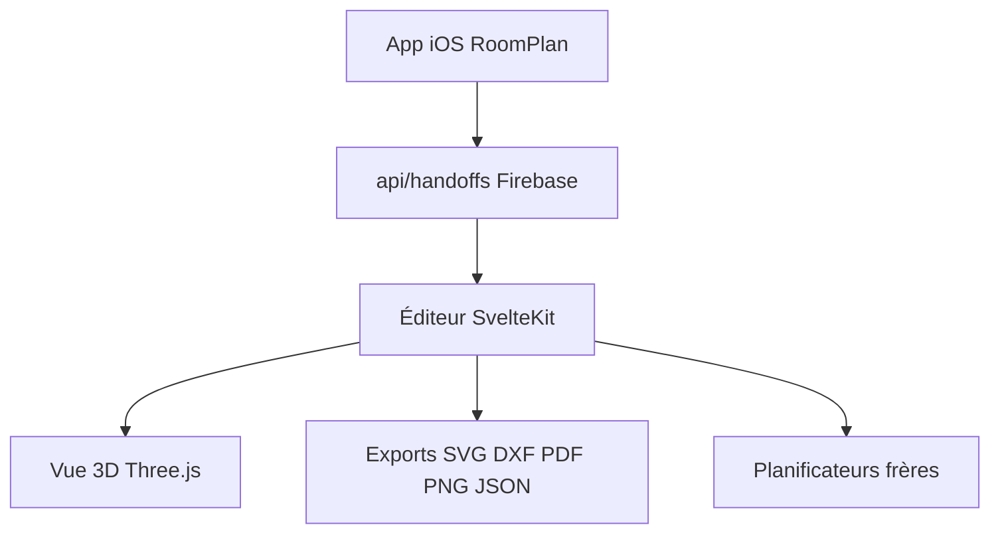

# laanlabs/openPlan3D

> Éditeur de plans d'étage en 2D avec aperçu 3D dans le navigateur, sans compte, pour particuliers.

## Le problème
Dessiner un plan d'intérieur puis le visualiser en 3D passe souvent par un compte ou un serveur distant.

## Ce que ça fait vraiment
Éditeur SvelteKit avec murs, portes, fenêtres, escaliers, pièces, meubles et vue 3D Three.js. Exports SVG, DXF, PDF, PNG et JSON ; import de scans Apple RoomPlan. Les projets restent dans le navigateur. Une application iPhone et des planificateurs frères échangent un JSON.

## Comment c'est branché


## Essayer
```bash
git clone https://github.com/laanlabs/openPlan3D.git
cd openPlan3D
npm ci
npm run dev
```

## Coût et pièges
Gratuit, Node.js 24 requis. Les transferts depuis l'iPhone passent par Firebase Storage, dont la facture n'est pas plafonnée par les limites du serveur. Un serveur MCP en lecture seule est désactivé par défaut.

## Ce que ce n'est pas
Pas un outil de BIM ou de CAO professionnel : un éditeur de plans d'étage léger.

## Alternatives
Aucune alternative nommée dans le README.

## Pour toi
À ignorer : un éditeur de plans d'intérieur, sans rapport avec un travail data, IA ou MLOps.

