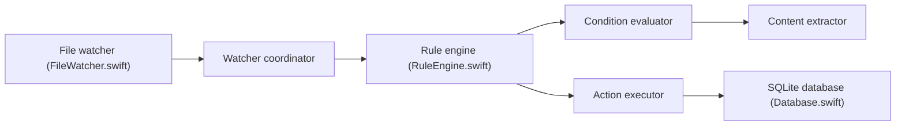

# lab421/forel

> macOS menu bar app that automatically organizes files according to rules, an alternative to Hazel.

## The problem
Folders like Downloads fill up and manual sorting is repetitive.

## What it is not just a tidy-up… (see below)

## What it actually does
Watches folders (FSEvents) and applies rules: name, extension, size, date, tags, content (local OCR via Vision). Actions: move, copy, rename, tag, trash, delete, run a script. Dry-run preview, history with undo, local SQLite database.

## How it is wired


## Trying it
```bash
brew install --cask lab421/tap/forel
git clone https://github.com/lab421/forel.git
cd forel
swift build
swift test
swift run
```

## Cost and gotchas
Free, processing on the machine, no API key. The "delete" and script actions are real: use the dry-run preview first. Inconsistency: the README cites both macOS 13 and 14.

## What it is not
Not a cloud or AI tool: no files are sent anywhere. Not available outside macOS.

## Alternatives
Hazel (paid), cited as the application it is an alternative to.

## For you
Ignore: a macOS file organization utility, unrelated to data, AI or MLOps.
