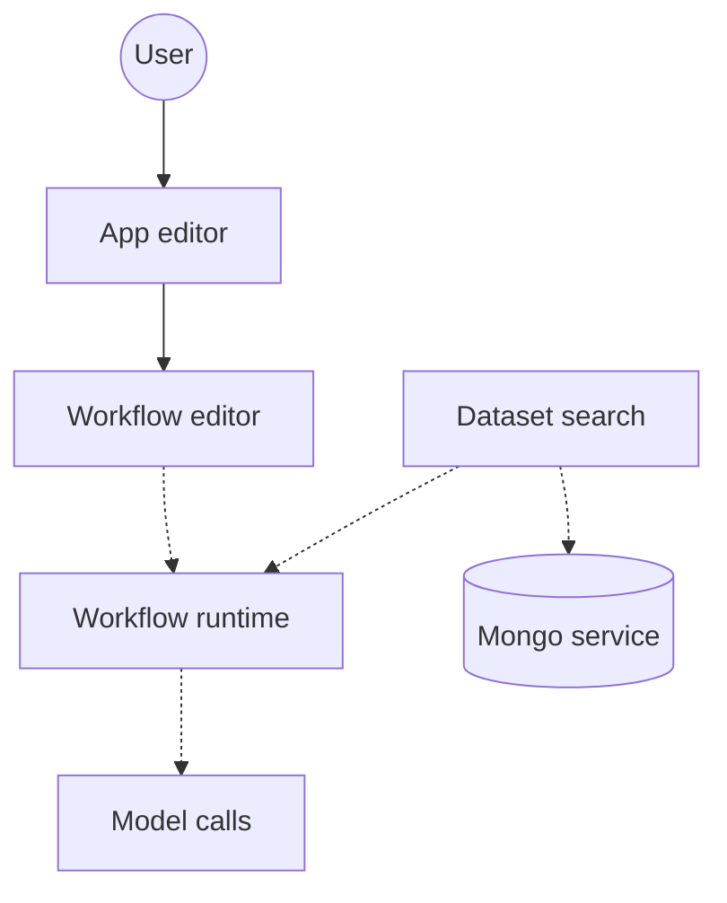

# labring/FastGPT

> AI agent building platform with visual workflows and a knowledge base, self-hostable.

## The problem
Assembling agents, RAG, tools and conversation tracking takes a lot of code and glue between services.

## What it actually does
Visual editor for applications and workflows (RPA-style nodes, bidirectional MCP), multi-format knowledge base (PDF, Word, CSV, URL) with hybrid search and reranking, call log, application evaluation, sharing without login and iframe integration. Mongo and Redis storage, background tasks run by workers.

## How it is wired

Several links in the supplied graph are marked as unverified.

## Trying it
```bash
bash <(curl -fsSL https://doc.fastgpt.io/deploy/install.sh)
docker compose up -d
```
Then http://localhost:3000, account `root`, password `1234`.

## Cost and gotchas
Default password to change. Model keys are required. A cloud version and a commercial version exist.

## What it is not
Not conventional free software: the FastGPT Open Source License allows commercial use as an internal service but forbids offering it as SaaS, and requires keeping copyright notices without a commercial agreement.

## Alternatives
None named in the README (it mentions AI Proxy and SiliconCloud as ecosystem).

## For you
Worth watching: handy for quickly standing up a visual RAG, but the license forbids reselling as SaaS; read it before any product use.
