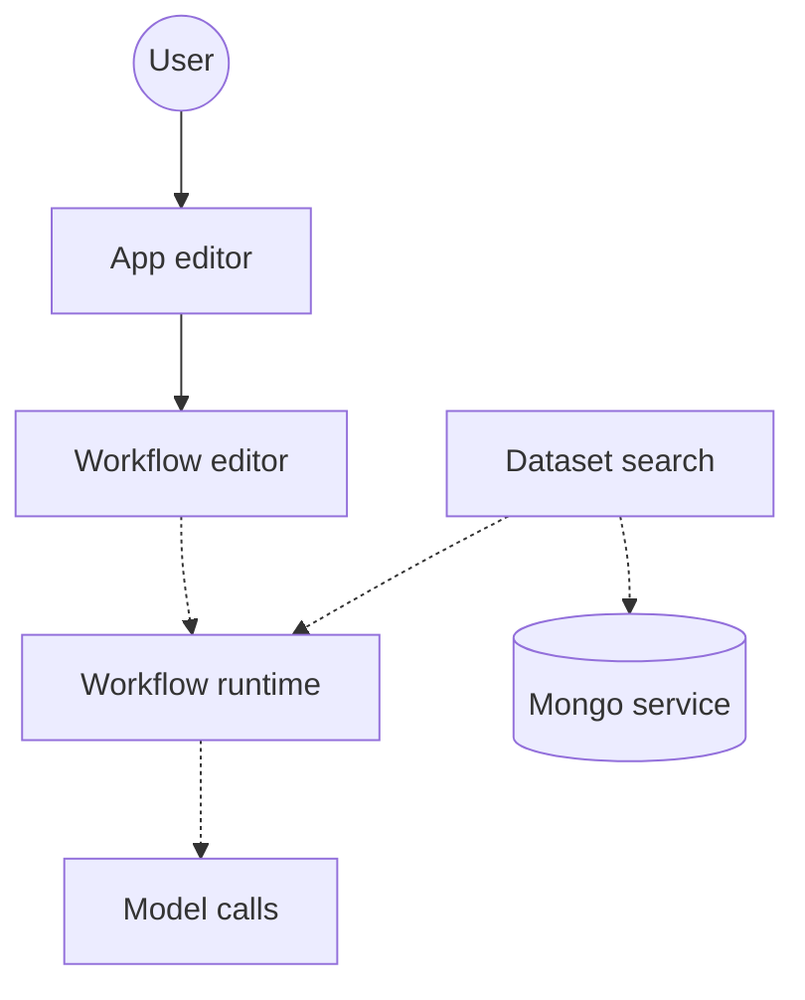

# labring/FastGPT

> Plateforme de construction d'agents IA avec workflows visuels et base de connaissances, auto-hébergeable.

## Le problème
Assembler agents, RAG, outils et suivi des conversations demande beaucoup de code et de bricolage entre services.

## Ce que ça fait vraiment
Éditeur visuel d'applications et de workflows (nœuds de type RPA, MCP bidirectionnel), base de connaissances multi-formats (PDF, Word, CSV, URL) avec recherche hybride et reranking, journal d'appels, évaluation d'applications, partage sans connexion et intégration par iframe. Stockage Mongo et Redis, tâches de fond par workers.

## Comment c'est branché

Plusieurs liens du graphe fourni sont marqués non vérifiés.

## Essayer
```bash
bash <(curl -fsSL https://doc.fastgpt.io/deploy/install.sh)
docker compose up -d
```
Puis http://localhost:3000, compte `root`, mot de passe `1234`.

## Coût et pièges
Mot de passe par défaut à changer. Il faut des clés de modèles. Une version cloud et une version commerciale existent.

## Ce que ce n'est pas
Pas un logiciel libre classique : la FastGPT Open Source License autorise l'usage commercial comme service interne mais interdit de proposer du SaaS, et impose de garder les mentions de copyright sans accord commercial.

## Alternatives
Aucune nommée dans le README (il cite AI Proxy et SiliconCloud comme écosystème).

## Pour toi
À surveiller : pratique pour monter vite un RAG visuel, mais la licence interdit une revente en SaaS ; à lire avant tout usage produit.

