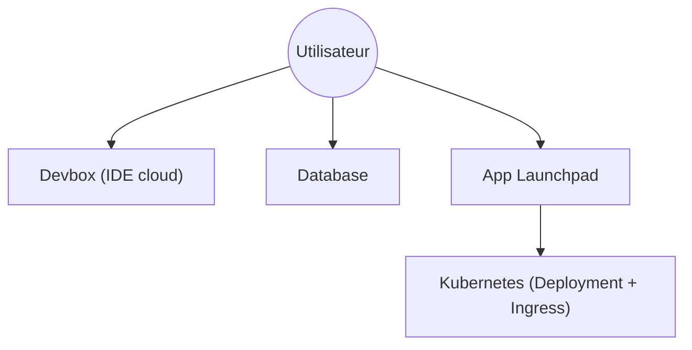

# labring/sealos

> Cloud operating system on Kubernetes: cloud IDE, managed databases and Docker image deployment.

## The problem
Setting up a development environment, databases and a deployment on Kubernetes requires heavy orchestration.

## What it actually does
Offers web applications: Devbox (cloud IDE for VSCode or Cursor), managed databases (MySQL, PostgreSQL, Redis, MongoDB), S3-compatible object storage, App Launchpad to deploy a Docker image, one-click App Store, per-workspace isolation. The README is short and marketing-oriented; the internal workings are not documented.

## How it is wired
No diagram provided and no architecture described: not documented in the README.

## Trying it
No documented command. To be written: open https://os.sealos.io, create an account, then launch Devbox, Database or App Launchpad from the interface.

## Cost and gotchas
The hosted service requires an account and its pricing is not specified in the README. Self-hosting is not explained here.

## What it is not
Not a tool to install: it is mostly a hosted platform. Not a "Kubernetes without complexity" promise verified by the README. The license is present but not identified.

## Alternatives
No alternative named in the README.

## For you
To ignore: a general-purpose cloud platform whose README details neither the license, nor the costs, nor the architecture; an MLOps profile has better sources.
