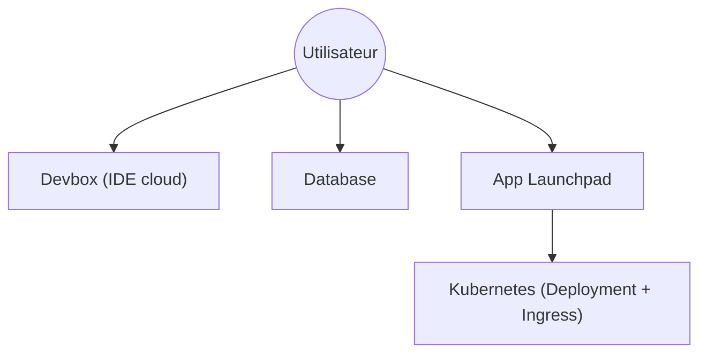

# labring/sealos

> Système d'exploitation cloud sur Kubernetes : IDE cloud, bases managées et déploiement d'images Docker.

## Le problème
Monter un environnement de développement, des bases de données et un déploiement sur Kubernetes demande de l'orchestration lourde.

## Ce que ça fait vraiment
Propose des applications web : Devbox (IDE cloud pour VSCode ou Cursor), bases managées (MySQL, PostgreSQL, Redis, MongoDB), stockage objet compatible S3, App Launchpad pour déployer une image Docker, App Store en un clic, isolation par espace de travail. Le README est court et marketing ; le fonctionnement interne n'est pas documenté.

## Comment c'est branché
Pas de diagramme fourni ni d'architecture décrite : non documenté dans le README.

## Essayer
Aucune commande documentée. À écrire : ouvrir https://os.sealos.io, créer un compte, puis lancer Devbox, Database ou App Launchpad depuis l'interface.

## Coût et pièges
Le service hébergé demande un compte et son tarif n'est pas précisé dans le README. L'auto-hébergement n'est pas expliqué ici.

## Ce que ce n'est pas
Pas un outil à installer : c'est surtout une plateforme hébergée. Pas une promesse de « Kubernetes sans complexité » vérifiée par le README. La licence est présente mais non identifiée.

## Alternatives
Aucune alternative nommée dans le README.

## Pour toi
À ignorer : plateforme cloud généraliste dont le README ne détaille ni la licence, ni les coûts, ni l'architecture ; un profil MLOps a de meilleures sources.

