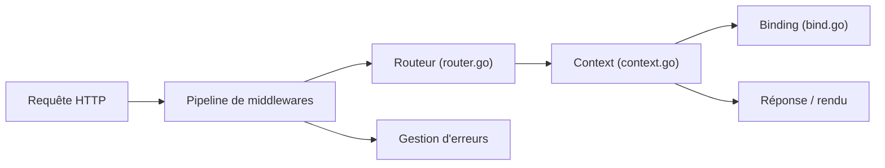

# labstack/echo

> Minimalist Go web framework on top of net/http, with router, binding and middlewares.

## The problem
The net/http package leaves advanced routing, request binding, centralised error handling and middlewares up to you.

## What it actually does
Adds a radix-tree router, route groups, middlewares at root, group or route level, JSON, XML and form binding with a pluggable validator, template rendering and centralised error handling. It handles automatic TLS (Let's Encrypt) and HTTP/2. The current version is v5. Official repositories provide JWT, OpenTelemetry and Prometheus.

## How it is wired


## Trying it
```bash
go get github.com/labstack/echo/v5
```
The README contains a complete Go example with e.Use(middleware.RequestLogger()), e.GET and e.Start(":8080").

## Cost and gotchas
Free; the latest version supports the last four major versions of Go. The README warns that third-party middlewares are not guaranteed by the team.

## What it is not
Not a full framework in the beego style: no built-in ORM or session management. The listed third-party middlewares carry no guarantee.

## Alternatives
No alternative cited in the README.

## For you
Worth watching: a good choice for a lightweight Go API in front of a model, but out of scope if your stack is Python.
