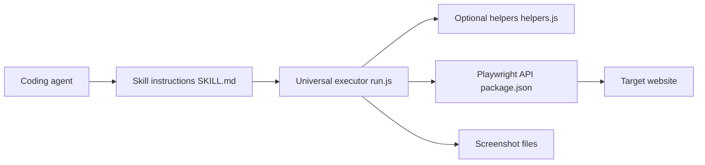

# lackeyjb/playwright-skill

> Agent skill that lets a coding assistant write and run Playwright scripts on demand.

## The problem
An agent that automates a browser needs a reliable executor, stable module resolution and guidance on Playwright.

## What it actually does
A skill (`SKILL.md`) and an API reference (`API_REFERENCE.md`) loaded on demand. A universal executor `run.js` runs the scripts written by the agent, with optional helpers. Visible browser by default (`headless: false`), with screenshots and console output returned. Installable as a skill or as a Claude Code plugin.

## How it is wired


## Trying it
```bash
npx skills add lackeyjb/playwright-skill --skill playwright-skill --global --yes
npm run setup
```
Or, in Claude Code: `/plugin marketplace add lackeyjb/playwright-skill` then `/plugin install playwright-skill@playwright-skill`.

## Cost and gotchas
Node, Playwright and Chromium installed by `npm run setup`. The scripts written by the agent run locally in a visible browser.

## What it is not
Not the simplest option for interactive driving: the README recommends `@playwright/cli` or `playwright-mcp` for that. Here the point is to keep a replayable script.

## Alternatives
- `@playwright/cli` (Microsoft): simple interactive browsing.
- `playwright-mcp`: tool-based control with accessibility snapshots.

## For you
Worth watching: useful if you want your agent to produce reusable Playwright tests or scrapers; otherwise the official options are enough.
