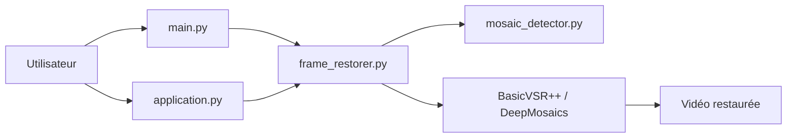

# ladaapp/lada

> Video restoration tool that removes pixelation from Japanese adult videos.

## The problem
Videos censored with mosaic are degraded; the goal is to reconstruct the pixelated areas.

## What it actually does
Processes video frame by frame: mosaic detection (YOLO segmentation) then restoration with BasicVSR++ or DeepMosaics. Graphical interface (real-time playback or export) and CLI `lada-cli --input`. The README warns that quality varies, sometimes worse than the original mosaic.

## How it is wired


## Trying it
```bash
lada-cli --input <input video path>
docker pull ladaapp/lada:latest
flatpak run io.github.ladaapp.lada
```

## Cost and gotchas
GPU with 4 to 6 GB of VRAM recommended (Nvidia Turing or newer, Intel Arc), 6 to 8 GB of RAM at 1080p, more at 4K. Without a GPU it is impractical. The project's home is Codeberg, GitHub is a mirror.

## What it is not
Not a general-purpose video restoration tool: it targets specific content. It is not suited to a professional pipeline.

## Alternatives
No alternative named in the README.

## For you
Ignore: consumer application with adult content, of no value for your work; only the technical angle (detection + restoration pipeline) is instructive.
