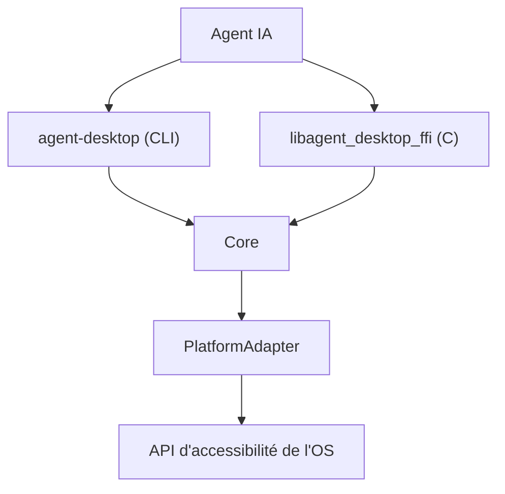

# lahfir/agent-desktop

> CLI and C library that let an AI agent drive desktop applications through the accessibility tree.

## The problem
Having an agent use a computer through screenshots is imprecise and costly.

## What it actually does
Reads an application's accessibility tree (macOS, Windows, Linux) and returns it as JSON, with a reference for each actionable element. The agent clicks, types, reads again to verify. No model is included: the loop lives in the agent. 60 commands, including snapshot, click, type, clipboard, and an MCP server mode.

## How it is wired


## Trying it
```bash
npm install -g agent-desktop
agent-desktop status
agent-desktop snapshot --app Finder -i
agent-desktop click @s8f3k2p9:e8
```

## Cost and gotchas
Free. On macOS, you must grant the Accessibility permission. Snapshots and the clipboard may contain private data: keep them out of public logs.

## What it is not
Not a complete agent: it has no model and plans nothing. Four commands (`key-down`, `key-up`, `mouse-down`, `mouse-up`) refuse to run for now.

## Alternatives
No alternative named in the README.

## For you
Worth watching: a useful building block to test a "computer use" agent without vision, but any agent acting on your machine calls for caution.
