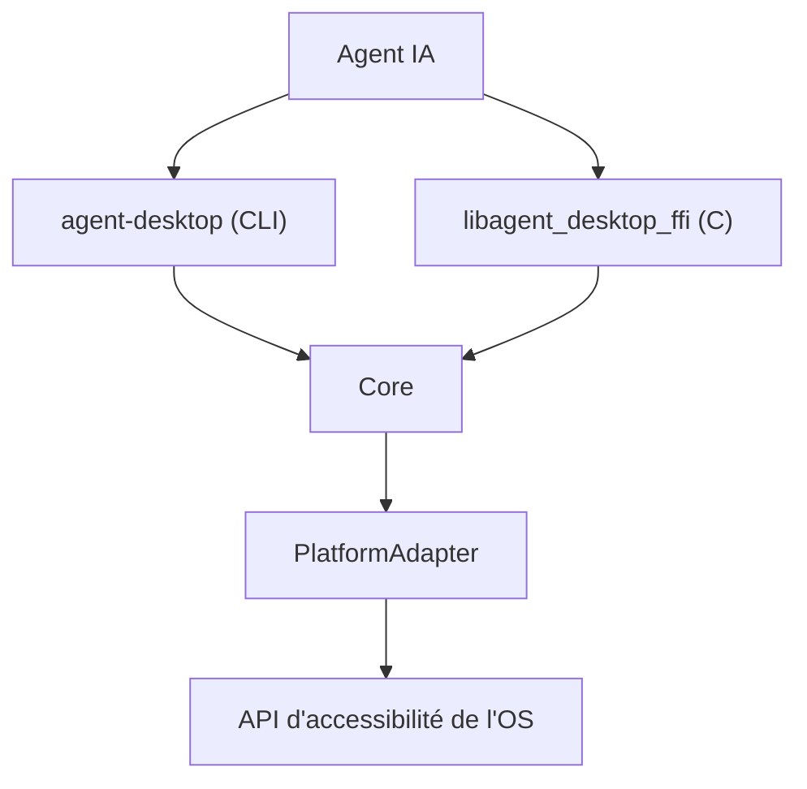

# lahfir/agent-desktop

> CLI et bibliothèque C qui laissent un agent IA piloter des applications de bureau via l'arbre d'accessibilité.

## Le problème
Faire utiliser un ordinateur à un agent par captures d'écran est imprécis et coûteux.

## Ce que ça fait vraiment
Lit l'arbre d'accessibilité d'une application (macOS, Windows, Linux) et le renvoie en JSON, avec une référence par élément actionnable. L'agent clique, saisit, lit à nouveau pour vérifier. Aucun modèle n'est inclus : la boucle vit chez l'agent. 60 commandes, dont snapshot, click, type, clipboard, et un mode serveur MCP.

## Comment c'est branché


## Essayer
```bash
npm install -g agent-desktop
agent-desktop status
agent-desktop snapshot --app Finder -i
agent-desktop click @s8f3k2p9:e8
```

## Coût et pièges
Gratuit. Sur macOS, il faut accorder la permission Accessibilité. Les snapshots et le presse-papiers peuvent contenir des données privées : à garder hors des journaux publics.

## Ce que ce n'est pas
Pas un agent complet : il n'a aucun modèle et ne planifie rien. Quatre commandes (`key-down`, `key-up`, `mouse-down`, `mouse-up`) refusent de s'exécuter pour l'instant.

## Alternatives
Aucune alternative nommée dans le README.

## Pour toi
À surveiller : brique utile pour tester un agent « computer use » sans vision, mais tout agent qui agit sur ton poste demande de la prudence.

